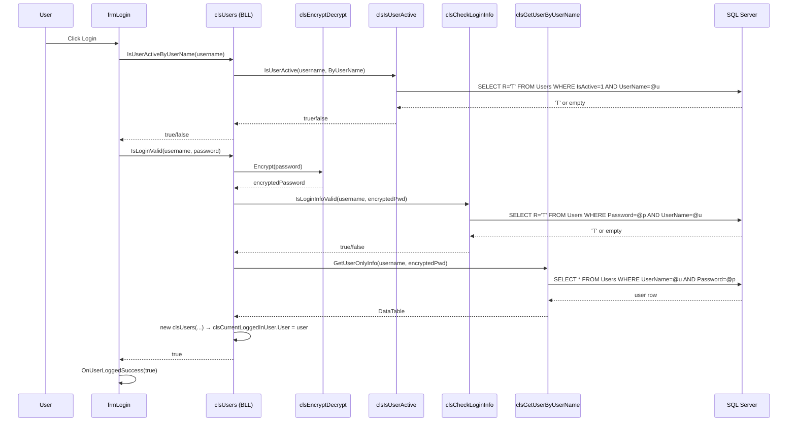
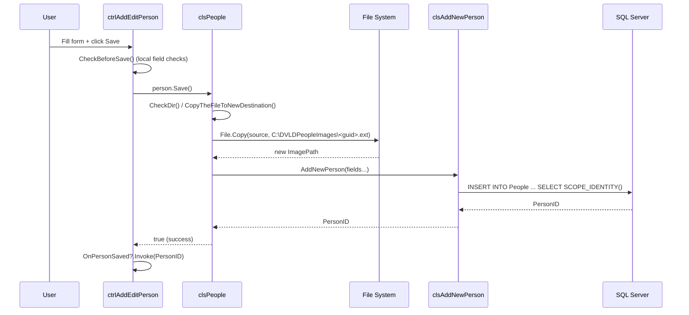

# 02 – Feature Documentation

[← Back to Index](./README.md)

---

## Table of Contents

- [Feature 1 – User Login and Authentication](#feature-1--user-login-and-authentication)
- [Feature 2 – Person Management (CRUD)](#feature-2--person-management-crud)
- [Feature 3 – User Management](#feature-3--user-management)
- [Feature 4 – Local Driving License Application](#feature-4--local-driving-license-application)
- [Feature 5 – Test Scheduling and Execution (Vision, Written, Practical)](#feature-5--test-scheduling-and-execution)
- [Feature 6 – Retake Test](#feature-6--retake-test)
- [Feature 7 – License Issuance](#feature-7--license-issuance)
- [Feature 8 – License Renewal](#feature-8--license-renewal)
- [Feature 9 – License Replacement](#feature-9--license-replacement)
- [Feature 10 – License Detention](#feature-10--license-detention)
- [Feature 11 – License Release](#feature-11--license-release)
- [Feature 12 – International Driving License](#feature-12--international-driving-license)
- [Feature 13 – Driver Registry and History](#feature-13--driver-registry-and-history)
- [Feature 14 – Reference Data Management](#feature-14--reference-data-management)

---

## Feature 1 – User Login and Authentication

### 4.1 Feature Overview

The login feature controls access to the entire application. Every time the application starts, `frmLogin` is shown. Only users whose `IsActive = 1` in the database and who supply the correct (encrypted) password are granted access. On success, the current user's information is stored in `clsCurrentLoggedInUser.User` for use throughout the session.

### 4.2 Requirements and Business Rules

- Username must exist in the database.
- The user account must be active (`IsActive = 1`).
- Password is compared after AES-256 encryption; plain-text passwords are never stored or transmitted.
- Minimum password length: 3 characters (enforced in `clsPUsersManagement.Update()`/`Add()`).
- "Remember Me" functionality persists credentials as JSON to `C:\DVLDSavedLoginInfo\SavedLogin.json`. Checking the box saves; unchecking deletes the file.
- Enter key triggers login.

### 4.3 Complete User Workflow

```
1. Application starts → frmLogin displayed.
2. Saved login file is read. If found and RememberMe = true,
   username and password fields are pre-populated.
3. User types username / password (or uses pre-populated values).
4. User clicks "Login" or presses Enter.
5. Validation:
   a. Empty username or password → MessageBox error.
   b. Username not active → MessageBox error.
   c. Credentials invalid → MessageBox error.
6. On success:
   - If "Remember Me" is checked: credentials saved to JSON.
   - clsCurrentLoggedInUser.User populated.
   - frmLogin raises OnUserLoggedSuccess(true).
   - frmMain is shown (wired in Program.cs).
```

### 4.4 Frontend Implementation

**File:** `FrontEnd/frmLogin.cs`

| UI Element | Role |
|---|---|
| `tbUsername` | Username text input |
| `tbPassword` | Password text input (masked) |
| `cbRememberme` | Checkbox for credential persistence |
| `btnLogin` | Triggers login attempt |
| `errorProvider1` | Shows inline errors for empty/invalid username or password |

Key events:
- `frmLogin_Load` – reads saved credentials via `clsUsers.GetSavedLoginInfo()`.
- `tbUsername_Validating` – checks username existence in real time.
- `btnLogin_Click` – orchestrates the full validation and login sequence.
- `ProcessCmdKey` – maps Enter key to `btnLogin_Click`.
- `cbRememberme_CheckedChanged` – saves or deletes the JSON credential file.

The form exposes `Action<bool> OnUserLoggedSuccess` which is wired in `Program.cs` to show `frmMain`.

### 4.5 Business Logic

**File:** `BussinessLogicLayer/clsUsers.cs`

Key static methods called during login:

| Method | What it does |
|---|---|
| `clsUsers.IsUserNameExist(username)` | Delegates to DAL; returns true if username exists in Users table |
| `clsUsers.IsUserActiveByUserName(username)` | Delegates to DAL; returns true if user IsActive = 1 |
| `clsUsers.IsLoginValid(username, password)` | Encrypts password then calls `clsCheckLoginInfo.IsLoginInfoValid()`; on success sets `clsCurrentLoggedInUser.User` |
| `clsUsers.SaveLoginInfoAsJson(u, p, flag)` | Serialises a `stLoginInfo` struct to JSON |
| `clsUsers.GetSavedLoginInfo(out u, out p)` | Deserialises JSON file; decrypts password |
| `clsUsers.DeleteSavedLoginInfo()` | Deletes JSON file |

Password encryption uses `clsEncryptDecrypt.Encrypt()` (AES-256, fixed key and IV). The encrypted Base64 string is what is compared with the stored value.

### 4.6 Database Interaction

**Tables:** `Users`, `People`

**Views used:**
- `BasicUserInfo` – joins `Users` with `People` to get full name.
- `DetailsUserInfo` – extends `BasicUserInfo` with password and IsActive.

**DAL classes:**

| DAL class | Query |
|---|---|
| `clsCheckUserExistence` | `SELECT 'T' FROM Users WHERE UserName = @UserName` (or `UserPersonID`) |
| `clsCheckLoginInfo` | `SELECT R='T' FROM Users WHERE Password = @Pass AND UserName = @UserName` |
| `clsIsUserActive` | `SELECT R='T' FROM Users WHERE IsActive=1 AND UserID/UserName/UserPersonID = @val` |
| `clsGetUserByUserName` | `SELECT * FROM Users WHERE UserName = @UserName AND Password = @Password` |

Connection is opened, command executed, connection closed in a `try/finally` block in every DAL class.

### 4.7 End-to-End Execution Flow



### 4.8 Design Decisions

- **Password never stored plain-text.** The AES key and IV are hardcoded in `clsEncryptDecrypt`. This is a pragmatic decision for a small internal tool; a production system would use a proper secrets store.
- **Static session state.** `clsCurrentLoggedInUser` is a static class holding the current user. This avoids passing user context through every call but is acceptable for a single-user desktop application.
- **"Remember Me" as JSON.** Credentials are serialised using `System.Text.Json` and stored encrypted on the local machine, avoiding the complexity of the Windows Credential Manager.

### 4.9 Feature Summary

| Item | Detail |
|---|---|
| Workflow | Login → validation → session start |
| Business rules | Active user, encrypted password match |
| Frontend | `frmLogin.cs` |
| BLL classes | `clsUsers`, `clsEncryptDecrypt`, `clsCurrentLoggedInUser` |
| DAL classes | `clsCheckUserExistence`, `clsCheckLoginInfo`, `clsIsUserActive`, `clsGetUserByUserName` |
| DB tables | `Users`, `People` |
| DB views | `BasicUserInfo`, `DetailsUserInfo` |

---

## Feature 2 – Person Management (CRUD)

### 4.1 Feature Overview

People are the root entity in DVLD. Every driver, user, and applicant is a `People` record. This feature allows staff to create, view, search, update, and delete person records, including a profile photograph.

### 4.2 Requirements and Business Rules

- **NationalNumber** must be unique (enforced by DB constraint `UQ_NationalNumber`).
- **Phone** must be unique (constraint `UQ_Phone`).
- **Email** must be unique (constraint `UQ_Email`).
- All names (first, second, third, last) are required.
- Minimum age 18 – enforced by setting `dtDateOfBirth.MaxDate = DateTime.Now.AddYears(-18)`.
- NationalNumber uniqueness checked on UI in real time before save.
- Image is physically copied to `C:\DVLDPeopleImages\` under a GUID-named filename. The path is stored in the DB; the original file is not moved.
- On update: old image file is deleted after the new one is confirmed.
- On delete: the image file is also deleted from disk.

### 4.3 Complete User Workflow

**Add:**
```
1. Main menu → People Management → click Add.
2. frmAddEditPerson(-1) opens, which hosts ctrlAddEditPerson(-1).
3. User fills: first/second/third/last name, national number, DOB, gender,
   phone, address, email, nationality, photo.
4. Photo is selected via OpenFileDialog; preview shown immediately.
5. btnSave_Click → CheckBeforeSave() validates all required fields.
6. person.Save() called → AddNewPerson() → image copied to target dir → DB insert.
7. Success → mode switches to Edit; OnPersonSaved event fires with new PersonID.
```

**Edit:**
```
1. People Management list → select row → right-click / Edit.
2. frmAddEditPerson(personID) → ctrlAddEditPerson(personID).
3. Form populated from DB via GetPersonObjectByPersonID().
4. User modifies fields → Save().
5. Old image path retrieved from DB, new image copied, old deleted on success.
```

**Delete:**
```
1. List → select → Delete button.
2. clsPeople.DeletePersonByPersonID(id) called.
3. Image path retrieved first, then DB record deleted, then image file deleted.
```

**Search:**
`FrmPeopleManagement` provides a filter combo and text box. Supported search criteria: PersonID, NationalNumber, FirstName, SecondName, ThirdName, LastName, Nationality, Gender, Phone, Email.

### 4.4 Frontend Implementation

| File | Role |
|---|---|
| `FrmPeopleManagement.cs` | List view with search/filter; hosts DataGridView |
| `frmAddEditPerson.cs` | Thin wrapper form; hosts `ctrlAddEditPerson` |
| `ctrlAddEditPerson.cs` | Full add/edit user control with all input fields |
| `ctrlPersonInfo.cs` | Read-only display control used by other forms |
| `ctrlFilterFindBy.cs` | Search-by-PersonID or NationalNo; raises `OnPersonFound` event |

`ctrlAddEditPerson` uses `errorProvider1` to display inline field errors for every required field.

The `OnPersonSaved` action event lets wrapper forms (e.g., `frmAddEditPerson`) obtain the new `PersonID` after saving.

### 4.5 Business Logic

**File:** `BussinessLogicLayer/clsPeople.cs`  
**Inherits:** `abPerson` (abstract base class defining all person properties)

| Method | Description |
|---|---|
| `clsPeople()` (default ctor) | Initialises Mode = Add |
| `clsPeople(...)` (private ctor) | Populates object from DB row; Mode = Update |
| `Save()` | Switch on Mode: Add → ImageMoveToNewDir() + AddNewPerson(); Update → ImageMoveToNewDir() + Update() + DeleteOldImage() |
| `AddNewPerson()` | Calls `clsAddNewPerson.AddNewPerson(...)` ; sets `this.PersonID` |
| `Update()` | Calls `clsUpdatePerson.UpdatePerson(...)` |
| `DeletePersonByPersonID(id)` | Static; retrieves image path then calls `clsDeletePerson.DeletePerson()` + `DeleteImageFromDir()` |
| `GetPersonObjectByPersonID(id)` | Static; queries `DetailedPersonInfo` view, constructs object |
| `GetPersonObjectByNationalNo(no)` | Static; same but searches by NationalNumber |
| `IsNationalNumberExists(no)` | Static; delegates to `clsCheckNationalNumExistence` |
| `GetAllCountries()` | Static; returns all country rows for the combo box |
| `GetPersonBy*()` methods | Static; return DataTable for the People list |

**Image lifecycle in `Save()`:**
1. `CheckDir()` – ensures `C:\DVLDPeopleImages\` exists; creates it if not.
2. `CopyTheFileToNewDestination()` – copies source file with a new GUID filename; updates `this.ImagePath`.
3. (Update only) `DeleteOldImage(OldPath)` – deletes the previous image if it still exists.

### 4.6 Database Interaction

**Tables:** `People`, `Countries`

**Views:**
- `ShowBasicPersonInfo` – joins People + Countries; maps Gender tinyint → 'M'/'F'.
- `DetailedPersonInfo` – extends `ShowBasicPersonInfo` with Address, DateOfBirth, ImagePath, NationalityCountryID.

**DAL classes:**

| DAL class | Operation |
|---|---|
| `clsAddNewPerson` | INSERT INTO People … SELECT SCOPE_IDENTITY() |
| `clsUpdatePerson` | UPDATE People SET … WHERE PersonID = @id |
| `clsDeletePerson` | DELETE FROM People WHERE PersonID = @id |
| `clsFindPersonBy` | SELECT * FROM ShowBasicPersonInfo/DetailedPersonInfo WHERE … |
| `clsGetBPersonInfo` | SELECT * FROM ShowBasicPersonInfo (full list) |
| `clsCheckNationalNumExistence` | SELECT 'T' FROM People WHERE NationalNumber = @n |
| `clsGetCountryIDByCountryName` | SELECT CountryID FROM Countries WHERE CountryName = @n |
| `clsListOfCountrires` | SELECT * FROM Countries |
| `clsGetPersonImagePathOnly` | SELECT ImagePath FROM People WHERE PersonID = @id |

`clsFindPersonBy` is notable for its use of a delegate pattern: a `cmdDelegate` is subscribed to the `cmd` method in the static constructor; `PrepareQuery()` switches on `enSearchPersonBy` enum and invokes the delegate with the appropriate SQL and parameter.

### 4.7 End-to-End Execution Flow



### 4.8 Design Decisions

- **Inheritance for shared person properties.** `abPerson` contains all properties common to persons. `clsPeople` extends it. `clsUsers` uses composition instead (it holds a `PersonID`), reflecting the real-world "is-a" vs "has-a" difference.
- **Image stored on disk, path in DB.** This avoids storing BLOBs in SQL Server. The trade-off is that the file system must remain consistent with the database; the code handles this by deleting old images atomically with updates.
- **GUID filenames.** Prevents collisions even when two persons upload identically named photos.

### 4.9 Feature Summary

| Item | Detail |
|---|---|
| Workflow | Add/Edit/Delete person + photo |
| Business rules | Unique national number, phone, email; minimum age 18; image required |
| Frontend | `FrmPeopleManagement`, `ctrlAddEditPerson`, `ctrlPersonInfo`, `ctrlFilterFindBy` |
| BLL | `clsPeople`, `abPerson` |
| DAL | `clsAddNewPerson`, `clsUpdatePerson`, `clsDeletePerson`, `clsFindPersonBy`, `clsGetBPersonInfo`, `clsCheckNationalNumExistence`, `clsGetCountryIDByCountryName`, `clsListOfCountrires`, `clsGetPersonImagePathOnly` |
| DB tables | `People`, `Countries` |
| DB views | `ShowBasicPersonInfo`, `DetailedPersonInfo` |

---

## Feature 3 – User Management

### 4.1 Feature Overview

System users are authority staff members who log into DVLD. Each user is linked to an existing `People` record. This feature allows administrators to add, edit, delete, and search users, as well as change their passwords.

### 4.2 Requirements and Business Rules

- A user must be linked to an existing person (`UserPersonID` FK to `People.PersonID`).
- `UserName` must be unique (DB constraint).
- Password minimum length: 3 characters.
- Passwords are stored AES-256 encrypted; never plain-text.
- A user cannot be deleted while they are the currently logged-in user.
- Only users who are active can log in.
- The currently logged-in user's saved login JSON is deleted when their own password changes, forcing a fresh login next time.
- A person can only be linked to one user account (enforced by `clsCheckUserExistence.IsPersonIsAUser()`).

### 4.3 Complete User Workflow

**Add user:**
```
1. Main → User Management → Add.
2. frmAddEditUser(-1, -1) opens.
3. User searches for or adds a person using ctrlFilterFindBy.
4. ctrlPersonInfo shows the found person.
5. User types username, password, IsActive selection.
6. Save → clsUsers.Save() (Add mode) → encrypts password → DB insert.
```

**Edit user:**
```
1. frmManageUsers → select row → Edit.
2. frmAddEditUser(userID, personID).
3. Fields populated. User modifies and saves.
```

**Change password:**
```
1. Main menu → Account → Change Password.
2. frmChangePassword(personID, userID) opens.
3. User types current password and new password (twice).
4. BLL validates current password matches stored encrypted value.
5. New password encrypted and saved.
```

**Delete user:**
```
1. frmManageUsers → select → Delete.
2. clsUsers.DeleteUserByUserID(id) checks the user is not currently active.
3. If safe, DAL deletes the Users row.
```

### 4.4 Frontend Implementation

| File | Role |
|---|---|
| `frmManageUsers.cs` | DataGridView of all users; search/filter by UserID, UserName, PersonID, FullName, IsActive |
| `frmAddEditUser.cs` | Add/edit user; embeds `ctrlFilterFindBy` and `ctrlPersonInfo` |
| `frmChangePassword.cs` | Password-change dialog |
| `ctrlShowUserInfo.cs` | Read-only user info display |
| `frmShowCurrentUserInfo.cs` | Shows logged-in user info; hosts `ctrlShowUserInfo` |

### 4.5 Business Logic

**Files:** `BussinessLogicLayer/clsUsers.cs`, `BussinessLogicLayer/clsPUsersManagement.cs`  
(`clsUsers` is a `partial` class split across two files)

| Method | Description |
|---|---|
| `clsUsers()` (public ctor, Add mode) | Mode = Add; IsEncrypted = false; UserID = -1 |
| `Add()` (private) | Validates password >= 3 chars; encrypts; calls `clsAddNewUser.AddNewUser()` |
| `Update()` (private) | Validates; if editing own account → deletes saved login JSON; encrypts new password; calls `clsUpdateUser.UpdateUser()` |
| `Save()` | Dispatches to Add or Update based on Mode |
| `DeleteUserByUserID(id)` | Checks user is not currently logged in; calls `clsDeleteUser` |
| `FindUserByUserIDAsObj(id)` | Returns full `clsUsers` object; used e.g., by `frmAddEditLocalDrivingLicense` to display "Created By" |
| `IsUserISAPerson(personID)` | Checks if a person already has a user account |
| `CheckIfNewPasswordMatchesTheOld(pwd)` | Compares encrypted versions |

### 4.6 Database Interaction

**Tables:** `Users`, `People`

**Views:** `BasicUserInfo`, `DetailsUserInfo`

**DAL classes:**

| DAL class | Operation |
|---|---|
| `clsAddNewUser` | INSERT INTO Users …; SELECT SCOPE_IDENTITY() |
| `clsUpdateUser` | UPDATE Users SET UserName, Password, IsActive WHERE UserID = @id |
| `clsDeleteUser` | DELETE FROM Users WHERE UserID = @id |
| `clsGetAllUsers` | SELECT * FROM BasicUserInfo |
| `clsFindUser` | SELECT from Users/BasicUserInfo by UserID, PersonID, UserName, FullName, IsActive |
| `clsCheckUserExistence` | Checks username exists or person is already a user |

### 4.7 End-to-End Execution Flow (Add User)

```mermaid
sequenceDiagram
    participant F as frmAddEditUser
    participant BLL as clsUsers (Add mode)
    participant E as clsEncryptDecrypt
    participant DAL as clsAddNewUser
    participant DB as SQL Server

    F->>BLL: user.Save()
    BLL->>BLL: Add() - validate pwd >= 3 chars
    BLL->>E: Encrypt(password)
    E-->>BLL: encryptedPwd
    BLL->>DAL: AddNewUser(personID, username, encryptedPwd, isActive)
    DAL->>DB: INSERT INTO Users ...; SELECT SCOPE_IDENTITY()
    DB-->>DAL: UserID
    DAL-->>BLL: UserID
    BLL-->>F: true
```

### 4.8 Design Decisions

- **`partial class clsUsers`** splits login/session functionality (`clsUsers.cs`) from user management CRUD (`clsPUsersManagement.cs`). This keeps each file focused.
- **Password encrypted before any DB write.** The same encryption is used for "Remember Me" JSON, ensuring passwords are never stored plain-text anywhere.
- **User linked to People via FK.** Avoids duplicating personal data in the Users table; the Users table stores only credentials and the link.

### 4.9 Feature Summary

| Item | Detail |
|---|---|
| BLL | `clsUsers` (partial: `clsUsers.cs` + `clsPUsersManagement.cs`) |
| DAL | `clsAddNewUser`, `clsUpdateUser`, `clsDeleteUser`, `clsGetAllUsers`, `clsFindUser`, `clsCheckUserExistence` |
| DB tables | `Users`, `People` |
| DB views | `BasicUserInfo`, `DetailsUserInfo` |

---

## Feature 4 – Local Driving License Application

### 4.1 Feature Overview

A Local Driving License Application (LDLA) is the entry point of the license-acquisition process. An applicant applies for a specific license class (e.g., Class 3 – Ordinary Driving License). The LDLA records the applicant, the desired class, the application fee, and serves as the parent record for all subsequent test appointments and the eventual license.

### 4.2 Requirements and Business Rules

- An applicant cannot apply for the same license class if they already have an **active and non-expired** license of that class.
- An applicant cannot have two **open** applications for the same license class simultaneously (status = New).
- Application fees are looked up from `ApplicationTypes` (type 1 = New Local Driving License, $15).
- The application can be **cancelled** or **deleted** before any test is taken.
- Deletion removes both the `LocalDrivingLicenseApplications` row **and** its parent `Applications` row atomically (T-SQL transaction in `clsDeleteLocalDrivingLicense`).
- Application status values: 1 = New, 2 = Cancelled, 3 = Completed.

### 4.3 Complete User Workflow

```
Add:
1. Menu → New Local Driving License Application.
2. frmAddEditLocalDrivingLicense(-1) opens.
3. ctrlFilterFindBy lets user find or add a person.
4. ctrlPersonInfo shows found person.
5. cbLicenseClass shows all license classes; default = Class 3.
6. Application info (datetime, fee, created-by) auto-populated.
7. btnSave → BLL checks: person already has active valid license of this class?
   → person already has open application for this class?
   → If both checks pass: saves Applications row → saves LDLA row.
8. Mode switches to Edit; LDLA ID shown in label.

Edit:
1. frmManageLocalDrivingLicenseApplications → select row → Edit.
2. frmAddEditLocalDrivingLicense(localAppID) loads existing record.
3. Person search disabled; only license class can be changed.
4. Save → updates Applications + LocalDrivingLicenseApplications.

Cancel / Delete:
- Context menu on the management form row.
- Cancel: UpdateApplicationStatusUsingLocalDrivingLicID(id, Cancelled).
- Delete: clsLocalDrivingLicenseApplications.Delete(id) → T-SQL transaction.
```

### 4.4 Frontend Implementation

| File | Role |
|---|---|
| `frmManageLocalDrivingLicenseApplications.cs` | Master list with search, filter by status, context menu with all actions |
| `frmAddEditLocalDrivingLicense.cs` | Add/edit LDLA; uses `ctrlFilterFindBy`, `ctrlPersonInfo`, `CtrlApplicationInfo` |
| `frmShowLocalDrivingLicApplicationDetails.cs` | Read-only detail view |

`frmManageLocalDrivingLicenseApplications.CheckScheduleTestForSelectedApplication()` dynamically enables/disables context-menu items based on the test-completion state of the selected application. This is one of the most complex pieces of logic in the frontend.

### 4.5 Business Logic

**File:** `BussinessLogicLayer/clsLocalDrivingLicenseApplication.cs`  
**Class:** `clsLocalDrivingLicenseApplications`

Key design: the class uses **composition** – it holds a `clsApplications Application` object. When saving, it first saves the parent `Application`, then the LDLA child record.

| Method | Description |
|---|---|
| `clsLocalDrivingLicenseApplications(personID)` (Add ctor) | Creates and auto-populates embedded `Application` object |
| `SaveLocalDrivingLicenseApplication()` | Mode switch: Add → checks, saves Application, saves LDLA; Edit → checks, updates both |
| `CheckBeforeSave()` | Calls `CheckApplicationExistence()` |
| `CheckApplicationExistence()` | `clsIsPersonHasRegisteredBeforeInApplication.IsPersonHasRegisteredBefore(personID, classID)` |
| `AddNewLocalDrivingLicenseApplicationToDB()` | DAL call to insert LDLA row after Application row exists |
| `Delete(id)` | `clsDeleteLocalDrivingLicense.DeleteLocalDrivingLicenseApplication(id)` – T-SQL transaction |
| `UpdateApplicationStatusUsingLocalDrivingLicID(id, status)` | Status update via DAL |
| `GetApplicationStatusByLocalLicenseApplicationID(id)` | Returns `enApplicationStatus` enum value |
| Static `GetLocalAppsBy*()` methods | Return DataTable for the management grid |

### 4.6 Database Interaction

**Tables:** `Applications`, `LocalDrivingLicenseApplications`, `ApplicationTypes`, `LicenseClasses`, `People`

**Views:** `LocalDrivingLicenseApplicationsView`, `DetailedApplicationInfo`, `ShowBasicInfoLocalDrivingLicense`

`LocalDrivingLicenseApplicationsView` includes a correlated subquery counting passed tests per LDLA – making it the primary source for the management-form DataGridView.

**Key T-SQL (Delete – transactional):**
```sql
BEGIN TRANSACTION;
  DECLARE @AppID INT;
  SELECT @AppID = LApplicationID FROM LocalDrivingLicenseApplications
    WHERE LocalDrivingLicenseApplicationID = @LocalAppID;
  DELETE LocalDrivingLicenseApplications
    WHERE LocalDrivingLicenseApplicationID = @LocalAppID;
  DELETE Applications WHERE ApplicationID = @AppID;
COMMIT TRANSACTION;
```

### 4.7 End-to-End Execution Flow

```mermaid
sequenceDiagram
    participant U as User
    participant F as frmAddEditLocalDrivingLicense
    participant BLL_LDL as clsLocalDrivingLicenseApplications
    participant BLL_App as clsApplications
    participant BLL_Lic as clsLicenses
    participant DAL1 as clsIsPersonHasRegisteredBeforeInApplication
    participant DAL2 as clsAddNewApplicationToApplicationTable
    participant DAL3 as clsAddNewLocalDrivingLicense
    participant DB as SQL Server

    U->>F: Click Save (Add mode)
    F->>BLL_LDL: SaveLocalDrivingLicenseApplication()
    BLL_LDL->>BLL_Lic: IsPersonHasThisLicenseActive(personID, classID)
    BLL_LDL->>DAL1: IsPersonHasRegisteredBefore(personID, classID)
    DAL1->>DB: SELECT R='T' FROM Applications + LDLA WHERE Status=New AND person=@p AND class=@c
    DB-->>DAL1: result
    DAL1-->>BLL_LDL: existingID or -1
    BLL_LDL->>BLL_App: Application.SaveApplication()
    BLL_App->>DAL2: AddNewApplication(fields...)
    DAL2->>DB: INSERT INTO Applications...; SELECT SCOPE_IDENTITY()
    DB-->>DAL2: ApplicationID
    DAL2-->>BLL_App: ApplicationID
    BLL_App-->>BLL_LDL: true
    BLL_LDL->>DAL3: AddNewLocalDrivingLicenseApplication(AppID, ClassID)
    DAL3->>DB: INSERT INTO LocalDrivingLicenseApplications...
    DB-->>DAL3: LDLA_ID
    DAL3-->>BLL_LDL: LDLA_ID
    BLL_LDL-->>F: true + OnSaveSuccessGetAppID(LDLA_ID)
```

### 4.8 Design Decisions

- **Composition over inheritance for Application.** `clsLocalDrivingLicenseApplications` holds a `clsApplications` object rather than extending it. This reflects that LDLA "has an" Application, not "is an" Application.
- **Transactional delete.** The delete operation wraps both table deletes in a T-SQL transaction to prevent orphaned LDLA records if the Applications delete fails.
- **`OnSaveErrorGetMessage` / `OnSaveSuccessGetAppID` Actions.** These callbacks avoid tight coupling between the BLL and the form for error messages and newly assigned IDs.

### 4.9 Feature Summary

| Item | Detail |
|---|---|
| BLL | `clsLocalDrivingLicenseApplications`, `clsApplications`, `clsLicenses`, `clsApplicationTypes` |
| DAL | `clsIsPersonHasRegisteredBeforeInApplication`, `clsAddNewApplicationToApplicationTable`, `clsAddNewLocalDrivingLicense`, `clsUpdateLocalDrivingLic`, `clsDeleteLocalDrivingLicense`, `clsGetLocalDrivingApp`, `clsGetAllLocalApps`, `clsFindLocalAppUsing`, `clsUpdateApplicationStatusUsingLocalDriving`, `clsGetBasicLocalLicenseApplicationInfo`, `clsGetApplicationStatusByLocalLicenseAppID`, `clsGetApplicantPersonIDByLDLAPPID` |
| DB tables | `Applications`, `LocalDrivingLicenseApplications`, `ApplicationTypes`, `LicenseClasses` |
| DB views | `LocalDrivingLicenseApplicationsView`, `ShowBasicInfoLocalDrivingLicense`, `DetailedApplicationInfo` |

---

## Feature 5 – Test Scheduling and Execution

### 4.1 Feature Overview

After a Local Driving License Application is created, the applicant must pass three sequential tests: Vision → Written → Practical. Each test requires scheduling an appointment, then sitting the test and recording the result. The results control which test can be scheduled next.

### 4.2 Requirements and Business Rules

- Tests must be taken in sequence: Vision must pass before Written can be scheduled; Written must pass before Practical can be scheduled.
- Each test type has a fixed fee (Vision $10, Written $20, Practical $30 – from `TestTypes` table).
- A test appointment can only be **scheduled once** while it is unlocked. Once taken, the appointment is **locked** (IsLocked = 1) and cannot be edited.
- An appointment for the same test type cannot be added if an unlocked appointment already exists.
- If the previous appointment for a test type is locked and the result was a pass, no new appointment for that type can be created.
- The `frmManageLocalDrivingLicenseApplications` form enforces sequencing by enabling/disabling schedule menu items via `clsCheckExistence`.

### 4.3 Complete User Workflow (per test type)

```
1. In frmManageLocalDrivingLicenseApplications, select an LDLA.
2. Context menu → Schedule Vision Test (or Written, or Practical).
   (Only the appropriate test is enabled based on current progress.)
3. The appointment form opens (e.g., frmTestVisionAppointments).
4. User sets an AppointmentDateTime.
5. Save → BLL validates:
   - Application not cancelled.
   - No unlocked appointment already exists.
   - This test type has not already been passed.
   - (If previous appointment is locked and was a fail → Retake path – see Feature 6.)
6. On success: TestAppointments row inserted.
7. Later: user opens the same form, selects the appointment, opens frmTakeTest.
8. frmTakeTest shows Pass/Fail radio + notes. User submits.
9. BLL: creates Test row, locks the appointment.
```

### 4.4 Frontend Implementation

| File | Role |
|---|---|
| `frmTestVisionAppointments.cs` | Schedule/edit vision appointments; launch frmTakeTest |
| `frmManageWrittenTestAppointments.cs` | Same for written tests |
| `frmManagePracticalTestAppointments.cs` | Same for practical tests |
| `frmTakeTest.cs` | Records pass/fail + notes; calls `clsTest.Save()` |
| `ctrlScheduleTestInfo.cs` | Displays appointment info in the scheduling forms |
| `ctrlRetakeTestInfo.cs` | Displayed when a retake is needed |

### 4.5 Business Logic

**Abstract base:** `clsAbTestAppointments`  
- Holds shared properties: `TestAppointmentID`, `TestTypeID`, `LocalDrivingLicenseApplicationID`, `AppointmentDateTime`, `PaidFees`, `CreatedByUserID`, `IsLocked`.
- Provides `AddNewTestAppointment()` (protected) calling `clsAddNewTestAppointment`.
- Constructor validates application is not cancelled (throws `InvalidOperationException` if it is).
- Declares abstract `Save()` and `UpdateAppointmentDateTime()`.

**Concrete classes:** `clsVisionTests`, `clsWrittenTest`, `clsPracticalTest` (all `sealed`, inherit `clsAbTestAppointments`)

Each concrete class follows the same `Save()` pattern:
```
Add mode:
  1. GetTestResultEnum(ldlAppID, testTypeID)
     - None  : first time
     - Pass  : already passed → error
     - Fail  : check if previous appointment is finished (locked)
               → if finished and failed → Retake path (Feature 6)
               → if not finished yet → error (open appointment exists)
  2. IsAppointmentAlreadyExists() → checks for unlocked appointment.
  3. AddNewTestAppointment() → inserts TestAppointments row.

Update mode:
  1. IsAppointmentLocked() → if true, error (cannot edit).
  2. UpdateAppointmentDateTime() → DAL update.
```

**`clsTest`** (test result recording):
- `Save()` – checks appointment is not already locked; calls `AddNewTest()`; then locks the appointment.
- Locking is type-aware: calls `clsVisionTests.LockVisionTestAppointment()`, `clsWrittenTest.LockWrittenTestAppointment()`, or `clsPracticalTest.LockPracticalTestAppointment()`.

### 4.6 Database Interaction

**Tables:** `TestAppointments`, `Test`, `TestTypes`, `LocalDrivingLicenseApplications`, `Applications`

**DAL classes for appointments:**

| DAL class | Operation |
|---|---|
| `clsAddNewTestAppointment` | INSERT INTO TestAppointments |
| `clsGetAllTestAppointments` | SELECT appointments for a given LDLA + test type |
| `clsGetAppointmentByAppointmentID` | SELECT single appointment |
| `clsUpdateTestAppointment` | UPDATE AppointmentDateTime |
| `clsLockTestAppointment` | UPDATE IsLocked = 1 |
| `clsIsTestAppointmentLocked` | SELECT R='T' WHERE IsLocked=1 AND TestAppointmentID=@id AND TestTypeID=@t |
| `clsCheckIfHasAppointmentAlreadyOrNot` | Checks for unlocked open appointment |
| `clsCheckIfThereIsOpenAppointmentBefore` | Checks whether previous appointment is locked (finished) |

**DAL classes for test results:**

| DAL class | Operation |
|---|---|
| `clsAddNewTest` | INSERT INTO Test |
| `clsGetTestResultByTestAppointmentID` | SELECT TOP 1 TestResult WHERE LDLA_ID=@id AND TestTypeID=@t ORDER BY AppointmentDateTime DESC |
| `clsCheckIfTestHasFinishedOrNot` | Returns bool indicating pass for a test type/LDLA combination |
| `clsGetNumOfPassedTestsByLDLAppID` | COUNT(*) of passed tests for an LDLA |
| `clsGetNumOfTrialsOfTest` | COUNT(*) of all attempts for a test type/LDLA |

### 4.7 End-to-End Execution Flow (Vision Test Scheduling)

```mermaid
sequenceDiagram
    participant U as User
    participant F as frmTestVisionAppointments
    participant BLL as clsVisionTests
    participant AB as clsAbTestAppointments
    participant DAL1 as clsCheckIfHasAppointmentAlreadyOrNot
    participant DAL2 as clsGetTestResultByTestAppointmentID
    participant DAL3 as clsAddNewTestAppointment
    participant DB as SQL Server

    U->>F: Set datetime, click Save
    F->>BLL: visionTest.Save()
    BLL->>DAL2: GetTestResultEnum(ldlaID, VisionTestTypeID=1)
    DAL2->>DB: SELECT TOP 1 TestResult ...
    DB-->>DAL2: null / true / false
    DAL2-->>BLL: None / Pass / Fail
    BLL->>DAL1: HasAppointmentIsNotLocked(VisionTestTypeID, ldlaID)
    DAL1->>DB: SELECT R='T' FROM TestAppointments WHERE ... AND IsLocked=0
    DB-->>DAL1: exists or not
    DAL1-->>BLL: true/false
    BLL->>AB: AddNewTestAppointment()
    AB->>DAL3: AddNewTestAppointment(typeID, ldlaID, dateTime, fees, userID, false, null)
    DAL3->>DB: INSERT INTO TestAppointments...; SELECT SCOPE_IDENTITY()
    DB-->>DAL3: TestAppointmentID
    DAL3-->>AB: id
    AB-->>BLL: true
    BLL-->>F: true
```

### 4.8 Design Decisions

- **Template Method pattern.** `clsAbTestAppointments` provides the shared `AddNewTestAppointment()` implementation; concrete subclasses override `Save()` and `UpdateAppointmentDateTime()` for type-specific logic.
- **Locking mechanism.** Once a test is taken, the appointment is locked in the DB. This prevents editing appointment dates after the fact and ensures the test result is permanently associated with a specific slot.
- **Separate `clsTest` class.** Recording a result is independent of scheduling. `clsTest` only knows the appointment ID and delegates locking to the type-specific class, keeping responsibilities separate.

### 4.9 Feature Summary

| Item | Detail |
|---|---|
| BLL | `clsAbTestAppointments`, `clsVisionTests`, `clsWrittenTest`, `clsPracticalTest`, `clsTest`, `clsCheckExistence` |
| DAL | `clsAddNewTestAppointment`, `clsGetAllTestAppointments`, `clsGetAppointmentByAppointmentID`, `clsUpdateTestAppointment`, `clsLockTestAppointment`, `clsIsTestAppointmentLocked`, `clsCheckIfHasAppointmentAlreadyOrNot`, `clsCheckIfThereIsOpenAppointmentBefore`, `clsAddNewTest`, `clsGetTestResultByTestAppointmentID`, `clsCheckIfTestHasFinishedOrNot`, `clsGetNumOfPassedTestsByLDLAppID`, `clsGetNumOfTrialsOfTest` |
| DB tables | `TestAppointments`, `Test`, `TestTypes` |

---

## Feature 6 – Retake Test

### 4.1 Feature Overview

If an applicant fails a test (Vision, Written, or Practical), they may schedule a retake. A retake requires a separate fee application (type 7 = Retake Test, $5) and creates a new `TestAppointments` row with the `RetakeApplicationID` populated.

### 4.2 Requirements and Business Rules

- Retake is only possible if the **previous appointment is locked** (test was taken and scored as Fail).
- A new `Applications` row of type `RetakeTest` is created for each retake.
- The retake application is immediately completed after the new appointment is booked.
- Retake fee: set to the fee of `RenewDrivingLicense` application type in the code (this appears to be a bug – the intent is the `RetakeTest` application type fee; the code uses `clsApplicationTypes.enApplicationTypes.RenewDrivingLicense` for the fee lookup).

### 4.3 Complete User Workflow

```
1. User opens the relevant test-scheduling form for an LDLA.
2. BLL detects: previous appointment is locked AND result = Fail.
3. BLL automatically enters retake path (no separate user action needed).
4. clsRetakeTest:
   a. Creates a new Application (type = RetakeTest).
   b. Saves the application → gets ApplicationID.
   c. Inserts a new TestAppointments row with RetakeApplicationID = new ApplicationID.
   d. Marks the application as Completed.
5. The new appointment ID is returned to the scheduling form.
```

### 4.4 Business Logic

**File:** `BussinessLogicLayer/clsRetakeTest.cs`  
**Class:** `clsRetakeTest` (`internal sealed`, inherits `clsAbTestAppointments`)

The class is instantiated inside `clsVisionTests.Save()`, `clsWrittenTest.Save()`, and `clsPracticalTest.Save()` when both:
- `IsThePerviousHasFinished()` → true (previous appointment locked)
- `GetTestResultEnum()` → Fail

Constructor immediately:
1. Creates a `clsApplications` in Add mode.
2. Sets `ApplicationTypeID = RetakeTest`.
3. Calls `SaveApplication()` to get the `ApplicationID`.

`Save()`:
1. Calls `AddNewTestAppointment()` with the `RetakeTestApplicationID`.
2. Updates application status to Completed.

### 4.6 Database Interaction

The `RetakeApplicationID` column in `TestAppointments` links each retake appointment to its fee application. This column is nullable – first-time appointments have `NULL`.

### 4.7 End-to-End Execution Flow

```mermaid
sequenceDiagram
    participant BLL_V as clsVisionTests.Save()
    participant BLL_R as clsRetakeTest
    participant BLL_App as clsApplications
    participant DAL_App as clsAddNewApplicationToApplicationTable
    participant DAL_Appt as clsAddNewTestAppointment
    participant DB as SQL Server

    BLL_V->>BLL_V: IsThePerviousHasFinished() = true AND result = Fail
    BLL_V->>BLL_R: new clsRetakeTest(...)
    BLL_R->>BLL_App: new clsApplications() [Add mode]
    BLL_R->>BLL_App: SaveApplication()
    BLL_App->>DAL_App: AddNewApplication(type=RetakeTest, ...)
    DAL_App->>DB: INSERT INTO Applications...; SCOPE_IDENTITY()
    DB-->>DAL_App: RetakeAppID
    DAL_App-->>BLL_App: AppID
    BLL_R->>BLL_R: Save()
    BLL_R->>DAL_Appt: AddNewTestAppointment(..., RetakeApplicationID=AppID)
    DAL_Appt->>DB: INSERT INTO TestAppointments WITH RetakeApplicationID
    DB-->>DAL_Appt: TestAppointmentID
    BLL_R->>BLL_App: UpdateApplicationStatus(Completed)
    BLL_R-->>BLL_V: TestAppointmentID via OnSaveGetTheRetakeID
```

---

## Feature 7 – License Issuance

### 4.1 Feature Overview

After passing all three tests, a license can be issued. This creates records in the `Drivers` table (if first license) and the `Licenses` table, marks the parent Application as Completed, and sets the LDLA's effective status to Completed.

### 4.2 Requirements and Business Rules

- All three tests must be passed before the "Issue License" option becomes available (enforced in `frmManageLocalDrivingLicenseApplications.CheckScheduleTestForSelectedApplication()`).
- If the applicant is not already in the `Drivers` table, a new Driver record is created.
- License `IssueReason` = 1 (FirstTime) for new licenses.
- License `ExpirationDate` = `IssueDate` + `DefaultValidityLength` months (from `LicenseClasses`).
- License `PaidFees` = `ClassFees` from `LicenseClasses`.
- The `IsActive` flag is set to true on issuance.
- The parent `Application` status is updated to Completed after the license is saved.

### 4.3 Complete User Workflow

```
1. LDLA management form → select completed LDLA → Issue License.
2. frmAddNewLicense(localAppID) opens.
3. Form shows application info and license class details.
4. User confirms; clicks Issue.
5. BLL:
   a. Checks if driver exists; if not, creates Driver.
   b. Creates License record.
   c. Updates parent Application to Completed.
6. New license ID shown to user.
```

### 4.5 Business Logic

**File:** `BussinessLogicLayer/clsLicenses.cs`

Key constructor for new license:
```
clsLicenses(int ApplicationID, int LicenseClassID)
  - Mode = Add
  - LicenseDriverID = -1 (set later in Save())
  - ExpirationDate = IssueDate + DefaultValidityLength months
  - PaidFees = ClassFees from LicenseClasses
  - IsActive = true
  - IssueReason = FirstTime
  - ApplicantPersonID from Application object
```

`Save()` (Add mode):
1. `clsDrivers.IsDriverExists(personID)` → if false, `AddNewDriver()` → sets `LicenseDriverID`.
2. If driver exists, `clsDrivers.FindDriverObjByPersonID()` → gets `DriverID`.
3. `AddNewLicense()` → DAL insert.
4. `UpdateMainApplication()` → sets Application status to Completed.

### 4.6 Database Interaction

**Tables:** `Licenses`, `Drivers`, `Applications`, `LicenseClasses`

**DAL classes:**

| DAL class | Operation |
|---|---|
| `clsAddNewLicense` | INSERT INTO Licenses |
| `clsAddNewDriver` | INSERT INTO Drivers |
| `clsCheckIfThePersonIsDriverOrNot` | SELECT R='T' FROM Drivers WHERE DriverPersonID=@id |
| `clsFindDriverByPersonID` | SELECT * FROM Drivers WHERE DriverPersonID=@id |
| `clsGetDriverLicenseInfo` | SELECT from DriverLicenseInfo view by ApplicationID |
| `clsDisableLicenseByLicID` | UPDATE Licenses SET IsActive=0 WHERE LicenseID=@id |

### 4.7 End-to-End Execution Flow

```mermaid
sequenceDiagram
    participant F as frmAddNewLicense
    participant BLL_L as clsLicenses
    participant BLL_D as clsDrivers
    participant BLL_App as clsApplications
    participant DAL_D as clsAddNewDriver
    participant DAL_L as clsAddNewLicense
    participant DB as SQL Server

    F->>BLL_L: license.Save()
    BLL_L->>BLL_D: IsDriverExists(personID)
    BLL_D->>DB: SELECT R='T' FROM Drivers WHERE DriverPersonID=@id
    DB-->>BLL_D: false
    BLL_L->>BLL_D: AddNewDriver()
    BLL_D->>DAL_D: AddNewDriver(personID, userID, date)
    DAL_D->>DB: INSERT INTO Drivers
    DB-->>DAL_D: DriverID
    BLL_L->>BLL_L: LicenseDriverID = DriverID
    BLL_L->>DAL_L: AddNewLicense(appID, driverID, classID, issueDate, expDate, notes, fees, true, 1, userID)
    DAL_L->>DB: INSERT INTO Licenses; SCOPE_IDENTITY()
    DB-->>DAL_L: LicenseID
    BLL_L->>BLL_App: UpdateMainApplication() -> status = Completed
    BLL_L-->>F: true + GetLicenseIDAfterSaving(LicenseID)
```

---

## Feature 8 – License Renewal

### 4.1 Feature Overview

When a license is expired, the holder can renew it. Renewal creates a new Application (type = Renew), a new License record with the same class but a new expiry date, deactivates the old license, and deactivates any international license linked to the old license.

### 4.2 Requirements and Business Rules

- The old license must be **active** (`IsActive = true`).
- The old license must be **expired** (`ExpirationDate < today`).
- Renewal creates a new License with `IssueReason = Renew`.
- New expiry = today + `DefaultValidityLength` months.
- Old license is deactivated after successful renewal.
- Any active international license linked to the old license is deactivated.

### 4.3 Complete User Workflow

```
1. Menu → Renew Driving License.
2. frmRenewLicense opens.
3. User searches for license by License ID using ctrlFilterFindLicenseByLicID.
4. License info and renewal fee shown.
5. User adds optional notes; clicks Renew.
6. BLL validates (active + expired).
7. New Application and new License created; old license disabled.
```

### 4.5 Business Logic

**File:** `BussinessLogicLayer/clsRenewLicense.cs`

Constructor: gets old license object; creates new `clsApplications` (type = RenewDrivingLicense).

`Save()`:
1. `RenewApplication.SaveApplication()` → creates Application, gets ID.
2. Creates `new clsLicenses(applicationID, personID, classID, IssueReason.Renew)`.
3. Validates: `OldLicense.IsActive && IsTheOldLicenseExpired() && NewLicense.Save()`.
4. `clsInternationalLicense.DeactivateInternationalLicenseByLicID(oldLicID)`.
5. `RenewApplication.UpdateApplicationStatus(Completed)`.
6. `clsLicenses.DisableLicenseByLicenseID(oldLicID)`.
7. `OnSavingGetInfo(ApplicationID, NewLicense.LicenseID)` fired.

### 4.6 Database Interaction

Involves all the same tables as license issuance, plus `InternationalLicenses` for deactivation.

---

## Feature 9 – License Replacement

### 4.1 Feature Overview

A holder may replace a damaged or lost license. Both scenarios create a new Application (different type), a new License record (same class, same expiry as old license), and deactivate the old license.

### 4.2 Requirements and Business Rules

- Old license must be **active** and **not expired**.
- Old license must **not be detained**.
- `IssueReason` = 3 (ReplacementForDamage) or 4 (ReplacementForLost).
- New license inherits the **same expiration date** as the old license (unlike renewal).
- A guard (`enReplacementTime`) prevents double-submission within the same form session.

### 4.5 Business Logic

**File:** `BussinessLogicLayer/clsReplacementLicense.cs`

`Save()`:
1. Validates: not detained, `replacementTime == First`, application save succeeds.
2. `SetNewLicense()` – creates `clsLicenses` with `ReplacementForDamage` or `ReplacementForLost` issue reason and old expiry date.
3. Validates: old IsActive, not expired, new license Save().
4. `DeactivateInternationalLicenseByLicID(oldLicID)`.
5. `UpdateApplicationStatus(Completed)`.
6. `DisableLicenseByLicenseID(oldLicID)`.
7. `replacementTime = Second` (guard).

---

## Feature 10 – License Detention

### 4.1 Feature Overview

A license can be detained (confiscated) by authority staff. Detention records a fine fee and marks the license as detained. The license can only be detained once at a time (it must be released before it can be detained again).

### 4.2 Requirements and Business Rules

- License must be **active** and **not expired**.
- License must **not already be detained** (`ISReleased = 0` in `DetainedLicenses`).
- Fine fee must be > 0 (DB constraint `Chk_FineFees`).
- `ISReleased` defaults to 0 on insert.

### 4.5 Business Logic

**File:** `BussinessLogicLayer/clsDetainReleaseLicense.cs`

Constructor (Detain mode): takes `LicenseID`, loads license object, sets `IsReleased = false`.

`Save()` (Detain mode):
1. `CheckBeforeSave()` → `license.IsActive && IsLicenseStillValid() && !IsLicenseDetainedBefore()`.
2. `Add()` → `clsAddNewDetainedLicense.AddNewLicenseToDetainedLicenses(...)`.
3. Fires `OnSaveGetDetainInfo(DetainID)`.

---

## Feature 11 – License Release

### 4.1 Feature Overview

A detained license is released after the holder pays the release fee. Release creates a new Application (type = ReleaseDetainedDrivingLicense), updates the `DetainedLicenses` record with release info, and completes the release application.

### 4.2 Requirements and Business Rules

- License must be currently detained (`ISReleased = 0`).
- A new Application (type 5, fee $15) is created as part of the release.
- The `DetainedLicenses` row is updated with `ISReleased = 1`, `ReleasedDateTime`, `ReleasedByUserID`, `ReleaseApplicationID`.

### 4.5 Business Logic

`Save()` (Release mode):
1. If `IsReleased` already true → return false.
2. `AddNewReleaseApplication()` → creates and saves Application; gets ID.
3. `clsReleaseLicnese.ReleaseLicense(DetainID, ReleasedDateTime, ReleasedByUserID, ReleaseApplicationID)`.
4. Sets `IsReleased = true`.
5. `ReleaseApplication.UpdateApplicationStatus(Completed)`.

---

## Feature 12 – International Driving License

### 4.1 Feature Overview

A holder of an active, non-expired **Class 3** local driving license may apply for an international driving license. The international license is valid for the same duration as the underlying local license.

### 4.2 Requirements and Business Rules

- Applicant must have an **active, non-expired Class 3** local driving license.
- The local license must **not be detained**.
- Applicant must not already have an **active international license**.
- International license expiry = local license expiry.
- Fee: $50 (type 6 = New International Driving License).

### 4.5 Business Logic

**File:** `BussinessLogicLayer/clsInternationalLicense.cs`

Constructor: takes local `LicenseID`; loads license object; creates `clsApplications` in Add mode.

`CheckBeforeAdd()` validates all four conditions above.

`Save()`:
1. `InternationalNewApplication.SaveApplication()` → creates Application.
2. Mode = Add: checks `IsLicenseDetained(licenseID)`.
3. `Add()` → `clsAddNewInternationalLicense.AddNewInternationalLicense(...)`.
4. Fires `OnSaveGetInterLicID(internationalLicID, applicationID)`.

Note: The `clsLicenses.LicenseClassID` is compared with `enLicenseClasses.Class3 = 3`. International licenses are restricted to Class 3 (Ordinary Driving License) holders only.

---

## Feature 13 – Driver Registry and History

### 4.1 Feature Overview

The Drivers table acts as a registry of all persons who have ever been issued a local driving license. A driver record is created automatically during first-time license issuance. Staff can browse the driver list and view any driver's complete license history.

### 4.2 Business Logic

**File:** `BussinessLogicLayer/clsDrivers.cs`

- Searching: `ListDrivers()`, `FindDriverByDriverID()`, `FindDriverByPersonID()`, `FindDriverByNationalNo()`, `FindDriverByFullName()` all delegate to `clsFindDriver`.
- `Save()` → Add mode only → `clsAddNewDriver`.
- `IsDriverExists(personID)` → `clsCheckIfThePersonIsDriverOrNot`.

**License history:** `clsLicenses.GetAllLicenseByApplicantID(applicantID)` uses `clsLicenseHistory` DAL which queries the `Licenses` table joined with `LicenseClasses` filtered by `Applications.ApplicantPersonID`.

---

## Feature 14 – Reference Data Management

### 4.1 Feature Overview

Two lookup tables are editable by staff: `ApplicationTypes` and `TestTypes`. Both support viewing and updating fees and descriptions.

### 4.2 Business Logic

**`clsApplicationTypes`:** `FindAppObjByAppID()`, `GetAllAppTypes()`, `Save()` → `clsUpdateAppType`.  
**`clsTestTypes`:** `FindTestType()`, `GetAllTestTypes()`, `Save()` → `clsUpdateTestType`.

Both classes are lookup-only (no add/delete). The seven `ApplicationTypes` and three `TestTypes` are seeded via the DDL script.
