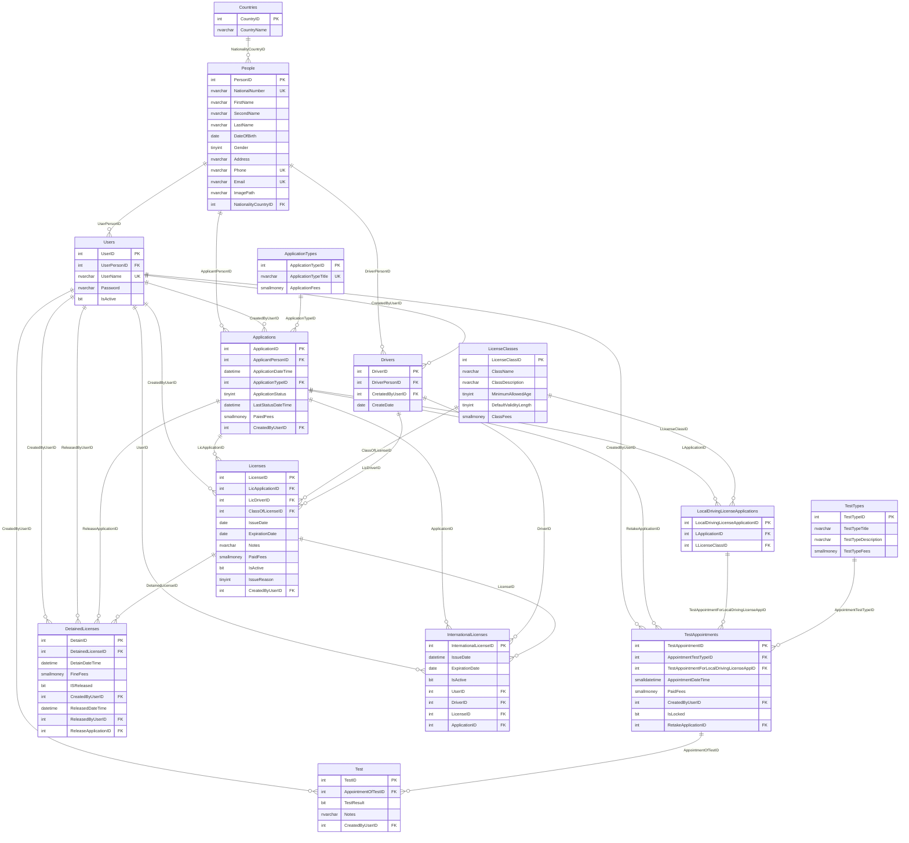

# 04 – Database Documentation

[← Back to Index](./README.md)

---

## 1. Database Overview

The DVLD database (named `MyDVLD` in the application connection string and `DLVD` in the DDL generation script) is a relational database hosted on Microsoft SQL Server. It serves as the single source of truth for the vehicle and driver licensing authority, recording every identity, credential, appointment, test attempt, license issuance, penalty, and regulatory fee transaction.

### Scope and Purpose
The database is designed to enforce strict legal integrity rules required of a government authority:
- A person can exist once (guaranteed by unique National Number, unique Phone, and unique Email).
- A system user must be bound to exactly one registered person.
- A person becomes a driver upon the successful issuance of their first driving license.
- All fee-accruing transactions (new local license, retake test, renew license, replacement, detain release, international license) are unified under a generalized **Applications** table.
- Specializations of applications (such as `LocalDrivingLicenseApplications`) inherit and link back to `Applications` using relational foreign keys.
- Test integrity is enforced through an appointment pipeline where each test type (Vision, Written, Practical) is scheduled, locked upon execution, and evaluated before license issuance.
- License status is tracked through lifecycle tables (`Licenses`, `DetainedLicenses`, `InternationalLicenses`).

---

## 2. Existing Database Diagrams

The repository contains two original database design documents created in [draw.io](https://app.diagrams.net/):

1. **Entity-Relationship Diagram (ERD):**
   - **Original File:** [`../Initial Db Design/ERD.drawio`](file:///m:/Temp%20Comparison/My%20Solution/Initial%20Db%20Design/ERD.drawio)
   - **Purpose:** Conceptual model illustrating the core entities (`Person`, `User`, `Driver`, `Application`, `ApplicationType`, `LicenseClass`, `LocalDrivingLicenseApplication`, `TestType`, `TestAppointment`, `Test`, `License`, `DetainedLicense`, `InternationalLicense`) and their cardinalities.
2. **Relational Schema Diagram:**
   - **Original File:** [`../Initial Db Design/Relational Schema.drawio`](file:///m:/Temp%20Comparison/My%20Solution/Initial%20Db%20Design/Relational%20Schema.drawio)
   - **Purpose:** Physical relational representation displaying primary keys, foreign keys, table columns, and constraint linkages.

> [!NOTE]
> To view the original Draw.io files, download or clone the repository and open them in the free web application [diagrams.net (draw.io)](https://app.diagrams.net/) or use the VS Code / Antigravity Draw.io Integration extension.

### 2.1 Complete Relational Entity-Relationship Diagram

Below is the complete database structure rendered in Mermaid ER syntax, directly representing the 14 tables, columns, primary keys, foreign keys, and relationships defined in `DDL.sql` and the DAL implementation:



---

## 3. Table-by-Table Documentation

### 3.1 `Countries`
- **Purpose:** Stores the catalog of recognized nations. Used to establish the nationality of registered persons.
- **Role in Business Domain:** Reference lookup table populated during initial database seed. Every person must be associated with exactly one country.

| Column | Data Type | Nullable | Default | PK/FK | Description & Constraints |
|---|---|---|---|---|---|
| `CountryID` | `int` | No | `IDENTITY(1,1)` | **PK** | Surrogate unique identifier for each country. |
| `CountryName` | `nvarchar(50)` | Yes | `NULL` | None | Full common name of the country (e.g., "Egypt", "United States"). |

- **Indexes & Constraints:** Primary key clustered index on `CountryID`.
- **Referenced By:** `People.NationalityCountryID` (Foreign Key).
- **Consuming Classes:** [clsListOfCountrires](file:///m:/Temp%20Comparison/My%20Solution/DataAccessLayer/clsListOfCountrires.cs), [clsGetCountryIDByCountryName](file:///m:/Temp%20Comparison/My%20Solution/DataAccessLayer/clsGetCountryIDByCountryName.cs).
- **Supported Operations:** Read/Select (all countries, find ID by name). Initial bulk insert from SQL script.

---

### 3.2 `People`
- **Purpose:** Master repository of human identities in the system. Represents citizens and residents who interact with the department as applicants, drivers, or system users.
- **Role in Business Domain:** Root anchor entity. No user, driver, or application can exist without a prior `People` record.

| Column | Data Type | Nullable | Default | PK/FK | Description & Constraints |
|---|---|---|---|---|---|
| `PersonID` | `int` | No | `IDENTITY(1,1)` | **PK** | Unique surrogate ID of the person. |
| `NationalNumber` | `nvarchar(20)` | No | None | **UK** | Unique national identification code / civil ID. Constraint `UQ_NationalNumber`. |
| `FirstName` | `nvarchar(20)` | No | None | None | First name. |
| `SecondName` | `nvarchar(20)` | No | None | None | Father's name / middle name. |
| `ThirdName` | `nvarchar(20)` | Yes | None | None | Grandfather's name (in DDL script added/present in Views and DAL). |
| `LastName` | `nvarchar(20)` | No | None | None | Family / surname. |
| `DateOfBirth` | `date` | No | None | None | Date of birth; used to evaluate minimum age requirements for licenses. |
| `Gender` | `tinyint` | No | None | None | `1` = Male ('M'), `2` = Female ('F'). |
| `Address` | `nvarchar(500)` | No | None | None | Physical residential street address. |
| `Phone` | `nvarchar(20)` | No | None | **UK** | Contact phone number. Constraint `UQ_Phone`. |
| `Email` | `nvarchar(50)` | No | None | **UK** | Contact email address. Constraint `UQ_Email`. |
| `ImagePath` | `nvarchar(250)` | Yes | `NULL` | None | Local filesystem path to stored portrait picture (`C:\DVLDPeopleImages\...`). |
| `NationalityCountryID` | `int` | No | None | **FK** | Foreign key references `Countries(CountryID)`. |

- **Indexes & Constraints:**
  - `PK_People` (Clustered PK on `PersonID`)
  - `UQ_NationalNumber` (Unique constraint on `NationalNumber`)
  - `UQ_Phone` (Unique constraint on `Phone`)
  - `UQ_Email` (Unique constraint on `Email`)
  - `FK_People_Countries` on `NationalityCountryID`
- **Referenced By:**
  - `Users.UserPersonID`
  - `Drivers.DriverPersonID`
  - `Applications.ApplicantPersonID`
- **Consuming Classes:**
  - BLL: [clsPeople](file:///m:/Temp%20Comparison/My%20Solution/BussinessLogicLayer/clsPeople.cs), [abPerson](file:///m:/Temp%20Comparison/My%20Solution/BussinessLogicLayer/abPerson.cs)
  - DAL: [clsAddNewPerson](file:///m:/Temp%20Comparison/My%20Solution/DataAccessLayer/clsAddNewPerson.cs), [clsUpdatePerson](file:///m:/Temp%20Comparison/My%20Solution/DataAccessLayer/clsUpdatePerson.cs), [clsDeletePerson](file:///m:/Temp%20Comparison/My%20Solution/DataAccessLayer/clsDeletePerson.cs), [clsFindPersonBy](file:///m:/Temp%20Comparison/My%20Solution/DataAccessLayer/clsFindPersonBy.cs), [clsCheckNationalNumExistence](file:///m:/Temp%20Comparison/My%20Solution/DataAccessLayer/clsCheckNationalNumExistence.cs), [clsGetBPersonInfo](file:///m:/Temp%20Comparison/My%20Solution/DataAccessLayer/clsGetBPersonInfo.cs), [clsGetDetailsPersonInfoByPersonID](file:///m:/Temp%20Comparison/My%20Solution/DataAccessLayer/clsGetDetailsPersonInfoByPersonID.cs), [clsGetPersonImagePathOnly](file:///m:/Temp%20Comparison/My%20Solution/DataAccessLayer/clsGetPersonImagePathOnly.cs).
- **Operations:** Insert (`SCOPE_IDENTITY()`), Update, Delete (if no child records exist in Users/Drivers/Applications), Select filtered by PersonID, NationalNumber, Name, Phone, Email, Gender, Country.

---

### 3.3 `Users`
- **Purpose:** Stores authenticated administrative system operators of the DVLD application.
- **Role in Business Domain:** Manages access credentials, active status, and audit trails. Every user corresponds to a registered `People` entity.

| Column | Data Type | Nullable | Default | PK/FK | Description & Constraints |
|---|---|---|---|---|---|
| `UserID` | `int` | No | `IDENTITY(1,1)` | **PK** | Unique surrogate ID of the operator. |
| `UserPersonID` | `int` | No | None | **FK** | Foreign key references `People(PersonID)`. A person can only be one user. |
| `UserName` | `nvarchar(20)` | No | None | **UK** | Unique login handle. Unique constraint `UQ_Users_UserName`. |
| `Password` | `nvarchar(20)` / `nvarchar(max)` | No | None | None | AES-256 encrypted password string in Base64 format. |
| `IsActive` | `bit` | No | None | None | Flag: `1` = Active (permitted to log in), `0` = Inactive / Deactivated. |

- **Indexes & Constraints:** Primary key on `UserID`, Unique on `UserName`, FK on `UserPersonID`.
- **Referenced By:** `Applications.CreatedByUserID`, `Drivers.CretatedByUserID`, `TestAppointments.CreatedByUserID`, `Test.CreatedByUserID`, `Licenses.CreatedByUserID`, `DetainedLicenses.CreatedByUserID`, `DetainedLicenses.ReleasedByUserID`, `InternationalLicenses.UserID`.
- **Consuming Classes:**
  - BLL: [clsUsers](file:///m:/Temp%20Comparison/My%20Solution/BussinessLogicLayer/clsUsers.cs) (partial), [clsPUsersManagement](file:///m:/Temp%20Comparison/My%20Solution/BussinessLogicLayer/clsPUsersManagement.cs), [clsCurrentLoggedInUser](file:///m:/Temp%20Comparison/My%20Solution/BussinessLogicLayer/clsCurrentLoggedInUser.cs).
  - DAL: [clsAddNewUser](file:///m:/Temp%20Comparison/My%20Solution/DataAccessLayer/clsAddNewUser.cs), [clsUpdateUser](file:///m:/Temp%20Comparison/My%20Solution/DataAccessLayer/clsUpdateUser.cs), [clsDeleteUser](file:///m:/Temp%20Comparison/My%20Solution/DataAccessLayer/clsDeleteUser.cs), [clsFindUser](file:///m:/Temp%20Comparison/My%20Solution/DataAccessLayer/clsFindUser.cs), [clsGetAllUsers](file:///m:/Temp%20Comparison/My%20Solution/DataAccessLayer/clsGetAllUsers.cs), [clsCheckLoginInfo](file:///m:/Temp%20Comparison/My%20Solution/DataAccessLayer/clsCheckLoginInfo.cs), [clsCheckUserExistence](file:///m:/Temp%20Comparison/My%20Solution/DataAccessLayer/clsCheckUserExistence.cs), [clsIsUserActive](file:///m:/Temp%20Comparison/My%20Solution/DataAccessLayer/clsIsUserActive.cs), [clsGetUserByUserName](file:///m:/Temp%20Comparison/My%20Solution/DataAccessLayer/clsGetUserByUserName.cs).
- **Operations:** Insert, Update (Password, IsActive, UserName), Delete (blocked if user has logged transactions or is currently active), Select by credentials, UserID, PersonID, FullName.

---

### 3.4 `Drivers`
- **Purpose:** Registry of individuals who have qualified for and been issued at least one driving license.
- **Role in Business Domain:** Represents licensed drivers. Created automatically upon the first successful issuance of a driving license to a person.

| Column | Data Type | Nullable | Default | PK/FK | Description & Constraints |
|---|---|---|---|---|---|
| `DriverID` | `int` | No | `IDENTITY(1,1)` | **PK** | Unique surrogate ID of the driver. |
| `DriverPersonID` | `int` | No | None | **FK** | Foreign key references `People(PersonID)`. Unique in business logic (1 driver per person). |
| `CretatedByUserID` | `int` | No | None | **FK** | Foreign key references `Users(UserID)` who registered the driver. |
| `CreateDate` | `date` | No | `CAST(GETDATE() AS Date)` | None | Calendar date when the person became a driver. |

- **Indexes & Constraints:** PK on `DriverID`, FKs on `DriverPersonID` and `CretatedByUserID`.
- **Referenced By:** `Licenses.LicDriverID`, `InternationalLicenses.DriverID`.
- **Consuming Classes:**
  - BLL: [clsDrivers](file:///m:/Temp%20Comparison/My%20Solution/BussinessLogicLayer/clsDrivers.cs).
  - DAL: [clsAddNewDriver](file:///m:/Temp%20Comparison/My%20Solution/DataAccessLayer/clsAddNewDriver.cs), [clsFindDriver](file:///m:/Temp%20Comparison/My%20Solution/DataAccessLayer/clsFindDriver.cs), [clsFindDriverByPersonID](file:///m:/Temp%20Comparison/My%20Solution/DataAccessLayer/clsFindDriverByPersonID.cs), [clsCheckIfThePersonIsDriverOrNot](file:///m:/Temp%20Comparison/My%20Solution/DataAccessLayer/clsCheckIfThePersonIsDriverOrNot.cs), [clsListDrivers](file:///m:/Temp%20Comparison/My%20Solution/DataAccessLayer/clsListDrivers.cs).
- **Operations:** Insert (`SCOPE_IDENTITY()`), Select (by DriverID, PersonID, NationalNumber, FullName).

---

### 3.5 `ApplicationTypes`
- **Purpose:** Catalog of formal service types handled by the department and their standard administrative service fees.
- **Role in Business Domain:** Lookup table defining fee structures for all workflows.

| Column | Data Type | Nullable | Default | PK/FK | Description & Constraints |
|---|---|---|---|---|---|
| `ApplicationTypeID` | `int` | No | `IDENTITY(1,1)` | **PK** | Unique identifier for service type (1 to 7). |
| `ApplicationTypeTitle` | `nvarchar(150)` | No | None | **UK** | Name of the service. Unique constraint. |
| `ApplicationFees` | `smallmoney` | Yes | None | None | Base fee charged for submitting this application type. |

**Standard Seeded Records:**
1. `New Local Driving License Service` — Fee: $15.00
2. `Renew Driving License Service` — Fee: $5.00
3. `Replacemnet for Lost Driving License` — Fee: $10.00
4. `Replacemnet for A Damaged Driving License` — Fee: $5.00
5. `Release Detained Driving License` — Fee: $15.00
6. `New International Driving License` — Fee: $50.00
7. `Retake Test` — Fee: $5.00

- **Consuming Classes:**
  - BLL: [clsApplicationTypes](file:///m:/Temp%20Comparison/My%20Solution/BussinessLogicLayer/clsApplicationTypes.cs).
  - DAL: [clsGetAllAppTypes](file:///m:/Temp%20Comparison/My%20Solution/DataAccessLayer/clsGetAllAppTypes.cs), [clsFindAppTypeByAppID](file:///m:/Temp%20Comparison/My%20Solution/DataAccessLayer/clsFindAppTypeByAppID.cs), [clsUpdateAppType](file:///m:/Temp%20Comparison/My%20Solution/DataAccessLayer/clsUpdateAppType.cs).
- **Operations:** Read/Select all or by ID, Update (Title and Fees). Insert/Delete prohibited by design.

---

### 3.6 `Applications`
- **Purpose:** Core generalized transaction table. Records all applications submitted to the licensing authority regardless of category.
- **Role in Business Domain:** Represents a billable transaction and lifecycle workflow state.

| Column | Data Type | Nullable | Default | PK/FK | Description & Constraints |
|---|---|---|---|---|---|
| `ApplicationID` | `int` | No | `IDENTITY(1,1)` | **PK** | Unique surrogate ID of the base application. |
| `ApplicantPersonID` | `int` | No | None | **FK** | Foreign key references `People(PersonID)`. |
| `ApplicationDateTime` | `datetime` | No | `GETDATE()` | None | Timestamp when application was initiated. |
| `ApplicationTypeID` | `int` | No | None | **FK** | Foreign key references `ApplicationTypes(ApplicationTypeID)`. |
| `ApplicationStatus` | `tinyint` | No | `1` | None | Status code: `1` = New, `2` = Cancelled, `3` = Completed. Constraint `CHK_AppStatus CHECK (ApplicationStatus IN (1,2,3))`. |
| `LastStatusDateTime` | `datetime` | Yes | None | None | Timestamp of the most recent status transition. |
| `PaiedFees` / `PaidFees` | `smallmoney` | No | None | None | Actual fee collected from the applicant for this transaction. |
| `CreatedByUserID` | `int` | No | None | **FK** | Foreign key references `Users(UserID)` who created/accepted the application. |

- **Indexes & Constraints:**
  - `PK_Applications` on `ApplicationID`
  - `CHK_AppStatus` checking `(ApplicationStatus IN (1,2,3))`
  - `Default_ApplicationStatus` default `1`
  - `FK_Applications_People`, `FK_Applications_ApplicationTypes`, `FK_Applications_Users`
- **Referenced By:**
  - `LocalDrivingLicenseApplications.LApplicationID`
  - `Licenses.LicApplicationID`
  - `TestAppointments.RetakeApplicationID`
  - `DetainedLicenses.ReleaseApplicationID`
  - `InternationalLicenses.ApplicationID`
- **Consuming Classes:**
  - BLL: [clsApplications](file:///m:/Temp%20Comparison/My%20Solution/BussinessLogicLayer/clsApplications.cs).
  - DAL: [clsAddNewApplicationToApplicationTable](file:///m:/Temp%20Comparison/My%20Solution/DataAccessLayer/clsAddNewApplicationToApplicationTable.cs), [clsUpdateApplication](file:///m:/Temp%20Comparison/My%20Solution/DataAccessLayer/clsUpdateApplication.cs), [clsDeleteApplication](file:///m:/Temp%20Comparison/My%20Solution/DataAccessLayer/clsDeleteApplication.cs), [clsGetApplicationByAppID](file:///m:/Temp%20Comparison/My%20Solution/DataAccessLayer/clsGetApplicationByAppID.cs), [clsGetDetailedAppInfoByApplicationID](file:///m:/Temp%20Comparison/My%20Solution/DataAccessLayer/clsGetDetailedAppInfoByApplicationID.cs).
- **Operations:** Insert (`SCOPE_IDENTITY()`), Update (`ApplicationStatus`, `LastStatusDateTime`), Delete, Select.

---

### 3.7 `LicenseClasses`
- **Purpose:** Defines the categories of driving licenses authorized by the department (motorcycles, private cars, commercial, buses, heavy vehicles).
- **Role in Business Domain:** Lookup table enforcing legal eligibility rules (minimum age, validity length, and class issuance fee).

| Column | Data Type | Nullable | Default | PK/FK | Description & Constraints |
|---|---|---|---|---|---|
| `LicenseClassID` | `int` | No | `IDENTITY(1,1)` | **PK** | Unique surrogate ID of the license class. |
| `ClassName` | `nvarchar(50)` | No | None | None | Official class title (e.g., "Class 3-Ordinary Driving License"). |
| `ClassDescription` | `nvarchar(50)` | Yes | None | None | Plain language description of authorized vehicles. |
| `MinimumAllowedAge` | `tinyint` | No | `18` | None | Legal minimum age in years required to hold this class. |
| `DefaultValidityLength` | `tinyint` | No | None | None | Standard duration of validity in years (or months as consumed by BLL). |
| `ClassFees` | `smallmoney` | No | None | None | Fee charged for issuing or renewing this class of license. |

**Standard Seeded Records:**
1. `Class 1-Small Motorcycle License` — Min Age: 18, Validity: 5 yrs, Fee: $15.00
2. `Class 2-Heavy Motocycle License` — Min Age: 21, Validity: 5 yrs, Fee: $30.00
3. `Class 3-Ordinary Driving License` — Min Age: 18, Validity: 10 yrs, Fee: $20.00
4. `Class 4-Commercial Driving License` — Min Age: 21, Validity: 10 yrs, Fee: $200.00
5. `Class 5-Agricultural Driving License` — Min Age: 21, Validity: 10 yrs, Fee: $50.00
6. `Class 6-Small And Medium Bus License` — Min Age: 21, Validity: 10 yrs, Fee: $300.00
7. `Class 7-Truck And Heavy Vechicle License` — Min Age: 21, Validity: 10 yrs, Fee: $300.00

- **Consuming Classes:**
  - BLL: [clsLicenseClasses](file:///m:/Temp%20Comparison/My%20Solution/BussinessLogicLayer/clsLicenseClasses.cs).
  - DAL: [clsGetAllLicenseClasses](file:///m:/Temp%20Comparison/My%20Solution/DataAccessLayer/clsGetAllLicenseClasses.cs), [clsFindLicenseClasssByClassID](file:///m:/Temp%20Comparison/My%20Solution/DataAccessLayer/clsFindLicenseClasssByClassID.cs), [clsGetLicenseClassIDByItsName](file:///m:/Temp%20Comparison/My%20Solution/DataAccessLayer/clsGetLicenseClassIDByItsName.cs).
- **Operations:** Read/Select all or by ID/ClassName.

---

### 3.8 `LocalDrivingLicenseApplications`
- **Purpose:** Specialization table establishing an "IS-A" relationship with `Applications` for local driving licenses.
- **Role in Business Domain:** Represents a specific request by an applicant to acquire a local license of a designated `LicenseClassID`.

| Column | Data Type | Nullable | Default | PK/FK | Description & Constraints |
|---|---|---|---|---|---|
| `LocalDrivingLicenseApplicationID` | `int` | No | `IDENTITY(1,1)` | **PK** | Unique surrogate ID of the local driving license application. |
| `LApplicationID` | `int` | No | None | **FK** | Foreign key references parent `Applications(ApplicationID)`. |
| `LLicenseClassID` | `int` | No | None | **FK** | Foreign key references requested `LicenseClasses(LicenseClassID)`. |

- **Indexes & Constraints:** PK on `LocalDrivingLicenseApplicationID`, FKs on `LApplicationID` and `LLicenseClassID`.
- **Referenced By:** `TestAppointments.TestAppointmentForLocalDrivingLicenseAppID`.
- **Consuming Classes:**
  - BLL: [clsLocalDrivingLicenseApplication](file:///m:/Temp%20Comparison/My%20Solution/BussinessLogicLayer/clsLocalDrivingLicenseApplication.cs).
  - DAL: [clsAddNewLocalDrivingLicense](file:///m:/Temp%20Comparison/My%20Solution/DataAccessLayer/clsAddNewLocalDrivingLicense.cs), [clsUpdateLocalDrivingLic](file:///m:/Temp%20Comparison/My%20Solution/DataAccessLayer/clsUpdateLocalDrivingLic.cs), [clsDeleteLocalDrivingLicense](file:///m:/Temp%20Comparison/My%20Solution/DataAccessLayer/clsDeleteLocalDrivingLicense.cs), [clsGetAllLocalApps](file:///m:/Temp%20Comparison/My%20Solution/DataAccessLayer/clsGetAllLocalApps.cs), [clsFindLocalAppUsing](file:///m:/Temp%20Comparison/My%20Solution/DataAccessLayer/clsFindLocalAppUsing.cs), [clsGetLocalDrivingApp](file:///m:/Temp%20Comparison/My%20Solution/DataAccessLayer/clsGetLocalDrivingApp.cs), [clsIsPersonHasRegisteredBefore](file:///m:/Temp%20Comparison/My%20Solution/DataAccessLayer/clsIsPersonHasRegisteredBefore.cs), [clsUpdateApplicationStatusUsingLocalDriving](file:///m:/Temp%20Comparison/My%20Solution/DataAccessLayer/clsUpdateApplicationStatusUsingLocalDriving.cs), [clsGetNumOfPassedTestsByLDLAppID](file:///m:/Temp%20Comparison/My%20Solution/DataAccessLayer/clsGetNumOfPassedTestsByLDLAppID.cs).
- **Operations:** Insert (`SCOPE_IDENTITY()`), Update (`LLicenseClassID`), Delete (within T-SQL transaction deleting parent `Applications` record), Select views.

---

### 3.9 `TestTypes`
- **Purpose:** Defines the three sequential testing gates required to earn a driving license.
- **Role in Business Domain:** Master lookup table containing test titles, test descriptions, and examination fees.

| Column | Data Type | Nullable | Default | PK/FK | Description & Constraints |
|---|---|---|---|---|---|
| `TestTypeID` | `int` | No | `IDENTITY(1,1)` | **PK** | Unique identifier (1 = Vision, 2 = Written, 3 = Practical). |
| `TestTypeTitle` | `nvarchar(100)` | No | None | None | Official name of test stage. |
| `TestTypeDescription` | `nvarchar(500)` | Yes | None | None | Purpose and criteria of the examination. |
| `TestTypeFees` | `smallmoney` | No | None | None | Administrative appointment fee charged to applicant. |

**Standard Seeded Records:**
1. `Vision Test` — Fee: $10.00 — Visual acuity assessment.
2. `Written Test` — Fee: $20.00 — Theory and road-rules test.
3. `Practical Test` — Fee: $30.00 — Behind-the-wheel driving assessment.

- **Consuming Classes:**
  - BLL: [clsTestTypes](file:///m:/Temp%20Comparison/My%20Solution/BussinessLogicLayer/clsTestTypes.cs).
  - DAL: [clsGetAllTestTypes](file:///m:/Temp%20Comparison/My%20Solution/DataAccessLayer/clsGetAllTestTypes.cs), [clsFindTestType](file:///m:/Temp%20Comparison/My%20Solution/DataAccessLayer/clsFindTestType.cs), [clsUpdateTestType](file:///m:/Temp%20Comparison/My%20Solution/DataAccessLayer/clsUpdateTestType.cs).
- **Operations:** Read/Select, Update (Title, Description, Fees).

---

### 3.10 `TestAppointments`
- **Purpose:** Schedules examination sessions for local driving license applicants across the three test types.
- **Role in Business Domain:** Represents scheduled test slots. An appointment is unlocked until taken, after which it is locked (`IsLocked = 1`) to preserve historical test records.

| Column | Data Type | Nullable | Default | PK/FK | Description & Constraints |
|---|---|---|---|---|---|
| `TestAppointmentID` | `int` | No | `IDENTITY(1,1)` | **PK** | Unique surrogate ID of the appointment. |
| `AppointmentTestTypeID` | `int` | No | None | **FK** | Foreign key references `TestTypes(TestTypeID)`. |
| `TestAppointmentForLocalDrivingLicenseAppID` | `int` | No | None | **FK** | Foreign key references `LocalDrivingLicenseApplications(LocalDrivingLicenseApplicationID)`. |
| `AppointmentDateTime` | `smalldatetime` | No | None | None | Date and time scheduled for the examination. |
| `PaidFees` | `smallmoney` | No | None | None | Fee collected for scheduling this appointment. |
| `CreatedByUserID` | `int` | No | None | **FK** | Foreign key references `Users(UserID)` who booked the appointment. |
| `IsLocked` | `bit` | No | None | None | Flag: `0` = Open/Editable, `1` = Locked (test taken or finalized). |
| `RetakeApplicationID` | `int` | Yes | `NULL` | **FK** | Foreign key references `Applications(ApplicationID)` if this appointment is a retake attempt. |

- **Indexes & Constraints:** PK on `TestAppointmentID`, FKs on `AppointmentTestTypeID`, `TestAppointmentForLocalDrivingLicenseAppID`, `CreatedByUserID`, `RetakeApplicationID`.
- **Referenced By:** `Test.AppointmentOfTestID`.
- **Consuming Classes:**
  - BLL: [clsAbTestAppointments](file:///m:/Temp%20Comparison/My%20Solution/BussinessLogicLayer/clsAbTestAppointments.cs), [clsVisionTests](file:///m:/Temp%20Comparison/My%20Solution/BussinessLogicLayer/clsVisionTests.cs), [clsWrittenTest](file:///m:/Temp%20Comparison/My%20Solution/BussinessLogicLayer/clsWrittenTest.cs), [clsPracticalTest](file:///m:/Temp%20Comparison/My%20Solution/BussinessLogicLayer/clsPracticalTest.cs), [clsRetakeTest](file:///m:/Temp%20Comparison/My%20Solution/BussinessLogicLayer/clsRetakeTest.cs).
  - DAL: [clsAddNewTestAppointment](file:///m:/Temp%20Comparison/My%20Solution/DataAccessLayer/clsAddNewTestAppointment.cs), [clsUpdateTestAppointment](file:///m:/Temp%20Comparison/My%20Solution/DataAccessLayer/clsUpdateTestAppointment.cs), [clsLockTestAppointment](file:///m:/Temp%20Comparison/My%20Solution/DataAccessLayer/clsLockTestAppointment.cs), [clsGetAllTestAppointments](file:///m:/Temp%20Comparison/My%20Solution/DataAccessLayer/clsGetAllTestAppointments.cs), [clsGetAppointmentByAppointmentID](file:///m:/Temp%20Comparison/My%20Solution/DataAccessLayer/clsGetAppointmentByAppointmentID.cs), [clsCheckIfThereIsOpenAppointmentBefore](file:///m:/Temp%20Comparison/My%20Solution/DataAccessLayer/clsCheckIfThereIsOpenAppointmentBefore.cs), [clsIsTestAppointmentLocked](file:///m:/Temp%20Comparison/My%20Solution/DataAccessLayer/clsIsTestAppointmentLocked.cs).
- **Operations:** Insert (`SCOPE_IDENTITY()`), Update (`AppointmentDateTime`), Update (`IsLocked = 1`), Select appointments per test type and application.

---

### 3.11 `Test`
- **Purpose:** Records the formal result of an administered examination appointment.
- **Role in Business Domain:** Official legal test outcome. Exactly one `Test` record corresponds to a taken appointment.

| Column | Data Type | Nullable | Default | PK/FK | Description & Constraints |
|---|---|---|---|---|---|
| `TestID` | `int` | No | `IDENTITY(1,1)` | **PK** | Unique surrogate ID of the test result. |
| `AppointmentOfTestID` | `int` | No | None | **FK** | Foreign key references `TestAppointments(TestAppointmentID)`. |
| `TestResult` | `bit` | Yes | None | None | Outcome: `1` = Passed, `0` = Failed. |
| `Notes` | `nvarchar(500)` | Yes | `NULL` | None | Examiner observations, performance notes, or reasons for failure. |
| `CreatedByUserID` | `int` | No | None | **FK** | Foreign key references `Users(UserID)` (examiner/clerk). |

- **Indexes & Constraints:** PK on `TestID`, FKs on `AppointmentOfTestID` and `CreatedByUserID`.
- **Consuming Classes:**
  - BLL: [clsTest](file:///m:/Temp%20Comparison/My%20Solution/BussinessLogicLayer/clsTest.cs).
  - DAL: [clsAddNewTest](file:///m:/Temp%20Comparison/My%20Solution/DataAccessLayer/clsAddNewTest.cs), [clsGetTestResultByTestAppointmentID](file:///m:/Temp%20Comparison/My%20Solution/DataAccessLayer/clsGetTestResultByTestAppointmentID.cs), [clsCheckIfTheTestHasTakenAndFailedOrNot](file:///m:/Temp%20Comparison/My%20Solution/DataAccessLayer/clsCheckIfTheTestHasTakenAndFailedOrNot.cs), [clsGetNumOfTrialsOfTest](file:///m:/Temp%20Comparison/My%20Solution/DataAccessLayer/clsGetNumOfTrialsOfTest.cs).
- **Operations:** Insert (`SCOPE_IDENTITY()`), Select (result and trial counts).

---

### 3.12 `Licenses`
- **Purpose:** Master repository of issued local driving licenses.
- **Role in Business Domain:** Official credential authorizing a driver to operate vehicles of a specified class.

| Column | Data Type | Nullable | Default | PK/FK | Description & Constraints |
|---|---|---|---|---|---|
| `LicenseID` | `int` | No | `IDENTITY(1,1)` | **PK** | Unique surrogate ID of the license document. |
| `LicApplicationID` | `int` | No | None | **FK** | Foreign key references parent `Applications(ApplicationID)` that led to issuance. |
| `LicDriverID` | `int` | No | None | **FK** | Foreign key references `Drivers(DriverID)`. |
| `ClassOfLicenseID` | `int` | No | None | **FK** | Foreign key references `LicenseClasses(LicenseClassID)`. |
| `IssueDate` | `date` | No | `CAST(GETDATE() AS Date)` | None | Calendar date of issuance. |
| `ExpirationDate` | `date` | No | None | None | Calendar date when license expires. |
| `Notes` | `nvarchar(500)` | Yes | `NULL` | None | Medical restrictions, endorsements, or remarks. |
| `PaidFees` | `smallmoney` | No | None | None | Fee collected for the license issue/renew/replacement. |
| `IsActive` | `bit` | No | None | None | Status: `1` = Active, `0` = Deactivated (replaced, renewed, or revoked). |
| `IssueReason` | `tinyint` | No | None | None | Enum reason: `1` = First Time, `2` = Renew, `3` = Replacement For Damage, `4` = Replacement For Lost. Check `IssueReason IN (1,2,3,4)`. |
| `CreatedByUserID` | `int` | No | None | **FK** | Foreign key references `Users(UserID)`. |

- **Indexes & Constraints:**
  - `PK_Licenses` on `LicenseID`
  - `CHK_IssueReason CHECK (IssueReason IN (1,2,3,4))`
  - FKs on `LicApplicationID`, `LicDriverID`, `ClassOfLicenseID`, `CreatedByUserID`.
- **Referenced By:** `DetainedLicenses.DetainedLicenseID`, `InternationalLicenses.LicenseID`.
- **Consuming Classes:**
  - BLL: [clsLicenses](file:///m:/Temp%20Comparison/My%20Solution/BussinessLogicLayer/clsLicenses.cs).
  - DAL: [clsAddNewLicense](file:///m:/Temp%20Comparison/My%20Solution/DataAccessLayer/clsAddNewLicense.cs), [clsDisableLicenseByLicID](file:///m:/Temp%20Comparison/My%20Solution/DataAccessLayer/clsDisableLicenseByLicID.cs), [clsCheckIfTheLicenseHasExpiredOrNot](file:///m:/Temp%20Comparison/My%20Solution/DataAccessLayer/clsCheckIfTheLicenseHasExpiredOrNot.cs), [clsCheckLicenseExistense](file:///m:/Temp%20Comparison/My%20Solution/DataAccessLayer/clsCheckLicenseExistense.cs), [clsGetLicenseInfoByID](file:///m:/Temp%20Comparison/My%20Solution/DataAccessLayer/clsGetLicenseInfoByID.cs), [clsGetLicenseByPersonID](file:///m:/Temp%20Comparison/My%20Solution/DataAccessLayer/clsGetLicenseByPersonID.cs), [clsGetDriverLicenseInfo](file:///m:/Temp%20Comparison/My%20Solution/DataAccessLayer/clsGetDriverLicenseInfo.cs), [clsLicenseHistory](file:///m:/Temp%20Comparison/My%20Solution/DataAccessLayer/clsLicenseHistory.cs).
- **Operations:** Insert (`SCOPE_IDENTITY()`), Update (`IsActive = 0`), Select (by LicenseID, PersonID, ApplicationID).

---

### 3.13 `DetainedLicenses`
- **Purpose:** Records legal detentions and impoundments of driving licenses, fine amounts, and release tracking.
- **Role in Business Domain:** Enforces disciplinary suspensions. A detained license cannot be renewed, replaced, or used to issue an international license until formally released.

| Column | Data Type | Nullable | Default | PK/FK | Description & Constraints |
|---|---|---|---|---|---|
| `DetainID` | `int` | No | `IDENTITY(1,1)` | **PK** | Unique surrogate ID of the detention event. |
| `DetainedLicenseID` / `DLicenseID` | `int` | No | None | **FK** | Foreign key references `Licenses(LicenseID)`. |
| `DetainDateTime` | `datetime` | No | `GETDATE()` | None | Timestamp when the license was seized/detained. |
| `FineFees` | `smallmoney` | No | None | None | Fine penalty imposed on the driver. |
| `ISReleased` | `bit` | No | `0` | None | Flag: `0` = Currently Detained / Impounded, `1` = Released. |
| `CreatedByUserID` | `int` | No | None | **FK** | Foreign key references `Users(UserID)` who executed detention. |
| `ReleasedDateTime` | `datetime` | Yes | `NULL` | None | Timestamp when fine was paid and license released. |
| `ReleasedByUserID` | `int` | Yes | `NULL` | **FK** | Foreign key references `Users(UserID)` who processed release. |
| `ReleaseApplicationID` | `int` | Yes | `NULL` | **FK** | Foreign key references `Applications(ApplicationID)` created for the release service. |

- **Indexes & Constraints:** PK on `DetainID`, Default `0` on `ISReleased`, FKs on `DetainedLicenseID`, `CreatedByUserID`, `ReleasedByUserID`, `ReleaseApplicationID`.
- **Consuming Classes:**
  - BLL: [clsDetainReleaseLicense](file:///m:/Temp%20Comparison/My%20Solution/BussinessLogicLayer/clsDetainReleaseLicense.cs).
  - DAL: [clsAddNewDetainedLicense](file:///m:/Temp%20Comparison/My%20Solution/DataAccessLayer/clsAddNewDetainedLicense.cs), [clsReleaseLicnese](file:///m:/Temp%20Comparison/My%20Solution/DataAccessLayer/clsReleaseLicnese.cs), [clsIsLicenseDetained](file:///m:/Temp%20Comparison/My%20Solution/DataAccessLayer/clsIsLicenseDetained.cs), [clsFindDetainedLicenseByLicneseID](file:///m:/Temp%20Comparison/My%20Solution/DataAccessLayer/clsFindDetainedLicenseByLicneseID.cs), [clsGetDetainedLicenseByDetainID](file:///m:/Temp%20Comparison/My%20Solution/DataAccessLayer/clsGetDetainedLicenseByDetainID.cs), [clsGetAllDetainedILic](file:///m:/Temp%20Comparison/My%20Solution/DataAccessLayer/clsGetAllDetainedILic.cs).
- **Operations:** Insert (`SCOPE_IDENTITY()`), Update (`ISReleased = 1`, `ReleasedDateTime`, `ReleasedByUserID`, `ReleaseApplicationID`), Select.

---

### 3.14 `InternationalLicenses`
- **Purpose:** Stores issued 1949 Geneva Convention international driving permits.
- **Role in Business Domain:** Secondary international credential issued to holders of an active Class 3 Ordinary driving license.

| Column | Data Type | Nullable | Default | PK/FK | Description & Constraints |
|---|---|---|---|---|---|
| `InternationalLicenseID` | `int` | No | `IDENTITY(1,1)` | **PK** | Unique surrogate ID of the international permit. |
| `IssueDate` / `IssueDateTime` | `datetime` | No | `GETDATE()` | None | Timestamp of issuance. |
| `ExpirationDate` | `date` | No | None | None | Expiration date (synchronized with local license validity or 1 year standard). |
| `IsActive` | `bit` | No | None | None | Flag: `1` = Active, `0` = Deactivated. |
| `UserID` | `int` | No | None | **FK** | Foreign key references `Users(UserID)` who issued permit. |
| `DriverID` | `int` | No | None | **FK** | Foreign key references `Drivers(DriverID)`. |
| `LicenseID` | `int` | No | None | **FK** | Foreign key references underlying local `Licenses(LicenseID)`. |
| `ApplicationID` | `int` | No | None | **FK** | Foreign key references service application in `Applications(ApplicationID)`. |

- **Indexes & Constraints:** PK on `InternationalLicenseID`, FKs on `UserID`, `DriverID`, `LicenseID`, `ApplicationID`.
- **Consuming Classes:**
  - BLL: [clsInternationalLicense](file:///m:/Temp%20Comparison/My%20Solution/BussinessLogicLayer/clsInternationalLicense.cs).
  - DAL: [clsAddNewInternationalLicense](file:///m:/Temp%20Comparison/My%20Solution/DataAccessLayer/clsAddNewInternationalLicense.cs), [clsDeactivateInternationalLicense](file:///m:/Temp%20Comparison/My%20Solution/DataAccessLayer/clsDeactivateInternationalLicense.cs), [clsCheckIfThePersonHasInternationalLicenseOrNot](file:///m:/Temp%20Comparison/My%20Solution/DataAccessLayer/clsCheckIfThePersonHasInternationalLicenseOrNot.cs), [clsIsInternatioalLicenseExistsByLocalLicenseID](file:///m:/Temp%20Comparison/My%20Solution/DataAccessLayer/clsIsInternatioalLicenseExistsByLocalLicenseID.cs), [clsFindInternationalLicenseBy](file:///m:/Temp%20Comparison/My%20Solution/DataAccessLayer/clsFindInternationalLicenseBy.cs), [clsGetInternationalLicenseInfo](file:///m:/Temp%20Comparison/My%20Solution/DataAccessLayer/clsGetInternationalLicenseInfo.cs), [clsInternationalLicensesAppsView](file:///m:/Temp%20Comparison/My%20Solution/DataAccessLayer/clsInternationalLicensesAppsView.cs).
- **Operations:** Insert (`SCOPE_IDENTITY()`), Update (`IsActive = 0`), Select.

---

## 4. Database Views Documentation

SQL Server database views are heavily utilized throughout DVLD to simplify complex multi-table joins and present ready-to-bind tabular data to the Windows Forms presentation layer.

| View Name | Source Tables Joined | Business Purpose & Display Columns |
|---|---|---|
| `ShowBasicPersonInfo` | `People`, `Countries` | Basic citizen grid: `PersonID`, `NationalNumber`, `FirstName`, `SecondName`, `ThirdName`, `LastName`, `Gender` ('M'/'F'), `Nationality`, `Phone`, `Email`. |
| `DetailedPersonInfo` | `ShowBasicPersonInfo`, `People` | Full demographic card: All basic person fields plus `Address`, `DateOfBirth`, `ImagePath`, `NationalityCountryID`. |
| `BasicUserInfo` | `Users`, `People` | User management grid: `UserID`, `UserPersonID`, `FullName`, `UserName`, `IsActive`. |
| `DetailsUserInfo` | `DetailedPersonInfo`, `Users` | Complete operator profile: All detailed person fields plus `UserID`, `UserName`, `Password`, `IsActive`. |
| `LocalDrivingLicenseApplicationsView` | `LocalDrivingLicenseApplications`, `LicenseClasses`, `Applications`, `People`, `Test`, `TestAppointments` | Main applications table: `L.D.LAppID`, `Driving Class`, `National No`, `Full Name`, `ApplicationDateTime`, subquery `[Passed Tests]` (count of passed tests 0-3), and mapped `Status` ('New', 'Cancelled', 'Completed'). |
| `DetailedApplicationInfo` | `Applications`, `ApplicationTypes`, `Users` | Application summary card: `ApplicationID`, `ApplicantPersonID`, `ApplicationDateTime`, `ApplicationType`, `ApplicationStatus`, `LastStatusDateTime`, `PaidFees`, `CreatedByUserName`. |
| `ShowBasicInfoLocalDrivingLicense` | `LocalDrivingLicenseApplications`, `LicenseClasses` | Header card: `LocalDrivingLicenseApplicationID`, `LApplicationID`, `ClassName`. |
| `DriverLicenseInfo` | `Applications`, `LocalDrivingLicenseApplications`, `Licenses`, `Drivers`, `People`, `LicenseClasses` | Driving license view card: `ClassName`, `FullName`, `LicenseID`, `NationalNumber`, `Gender`, `IssueDate`, `ExpirationDate`, `IsActive`, `DriverID`, `DateOfBirth`, `Notes`, `IssueReason` mapped title. |
| `ListDrivers` | `Drivers`, `People`, `Licenses` | Driver directory grid: `DriverID`, `PersonID`, `NationalNumber`, `Full Name`, `CreateDate`, subquery `[Active License]` count. |
| `ShowInternationalLicenseInfo` | `InternationalLicenses`, `Licenses`, `LicenseClasses` | Summary of international permit: `InternationalLicenseID`, `ApplicationID`, `ApplicantPersonID`, `ClassName`, `IssueDateTime`, `ExpirationDate`, `IsActive`. |
| `ShowInternationalLicensesInfo` | `InternationalLicenses`, `Licenses`, `Applications`, `People` | Full international license card: `FullName`, `InternationalLicenseID`, `LicenseID`, `NationalNumber`, `Gender`, `IssueDateTime`, `ApplicationID`, `IsActive`, `DateOfBirth`, `DriverID`, `ExpirationDate`. |
| `InternationalAppInfo` | `InternationalLicenses`, `Licenses`, `Applications`, `Users`, `ApplicationTypes` | Application view for international license: `ApplicationID`, `ApplicationDateTime`, `IssueDateTime`, `ApplicationFees`, `InternationalLicenseID`, `LicenseID`, `ExpirationDate`, `UserName`. |
| `InernationalLicenseApplications` | `InternationalLicenses` | International applications listing: `InternationalLicenseID`, `ApplicationID`, `DriverID`, `IssueDateTime`, `ExpirationDate`, `IsActive`. |
| `DetailedDetainInfo` | `DetainedLicenses`, `Licenses`, `Applications`, `People` | Detained license grid & details: `DetainID`, `DLicenseID`, `DetainDateTime`, `FineFees`, `ISReleased`, `ReleasedDateTime`, `NationalNumber`, `FullName`, `ReleaseApplicationID`. |

---

## 5. Relationships and Data Integrity

### 5.1 Relational Cardinalities
1. **Countries to People (`1:N`):** One country can be the nationality of many people; a person must have exactly one country of nationality.
2. **People to Users (`1:1` conceptual, `1:N` relational):** A user must reference a valid person. Enforced at the business layer via `clsCheckUserExistence.IsPersonIsAUser(PersonID)` so that no person can have multiple operator accounts.
3. **People to Drivers (`1:1` conceptual, `1:N` relational):** A driver references a person. Enforced in `clsLicenses.Save()`: if `clsDrivers.IsDriverExists(PersonID)` is false, a new driver record is created; otherwise the existing `DriverID` is reused.
4. **People to Applications (`1:N`):** A person can submit multiple applications over time (local, renewal, replacement, international).
5. **ApplicationTypes to Applications (`1:N`):** Each application references exactly one service type.
6. **Applications to LocalDrivingLicenseApplications (`1:1` specialization):** Each local driving license application points to exactly one parent record in `Applications`.
7. **LicenseClasses to LocalDrivingLicenseApplications (`1:N`):** Many applications can request the same license class.
8. **LocalDrivingLicenseApplications to TestAppointments (`1:N`):** A local license application can have multiple test appointments (Vision, Written, Practical, including retakes).
9. **TestTypes to TestAppointments (`1:N`):** Many appointments can be booked for a particular test type.
10. **TestAppointments to Test (`1:1`):** An appointment leads to at most one completed examination result. Once recorded, the appointment is locked.
11. **Applications to Licenses (`1:1` per issuance workflow):** The application that led to license issuance is referenced by `LicApplicationID`.
12. **Drivers to Licenses (`1:N`):** A driver may hold multiple licenses over time or across different vehicle classes.
13. **Licenses to DetainedLicenses (`1:N`):** A license can be detained and released multiple times throughout its lifecycle.
14. **Licenses to InternationalLicenses (`1:N`):** A local driving license (specifically Class 3) can serve as the prerequisite for international licenses.

### 5.2 Referential Integrity and Cascading
- Foreign keys in `DDL.sql` are created with `ON DELETE NO ACTION` (the SQL Server default).
- Deletions are controlled programmatically:
  - Deleting a person is blocked if child records exist in `Users`, `Drivers`, or `Applications`.
  - Deleting a local driving license application executes an explicit atomic T-SQL transaction in `clsDeleteLocalDrivingLicense`:
    ```sql
    BEGIN TRANSACTION;
    DECLARE @AppID INT;
    SELECT @AppID = LocalDrivingLicenseApplications.LApplicationID
    FROM LocalDrivingLicenseApplications
    WHERE LocalDrivingLicenseApplicationID = @LocalAppID;

    DELETE LocalDrivingLicenseApplications
    WHERE LocalDrivingLicenseApplicationID = @LocalAppID;

    DELETE Applications
    WHERE Applications.ApplicationID = @AppID;
    COMMIT TRANSACTION;
    ```

---

## 6. Database Operations & Mechanisms

### 6.1 Connection & Command Management
- Centralized in `DataAccessLayer.dbSettings.DbConnection()`:
  ```csharp
  internal static class dbSettings
  {
      static string ConnectionString =
          @"Server=OSAMA-PC;Database=MyDVLD;Integrated Security=True;TrustServerCertificate=True;";

      public static SqlConnection DbConnection()
      {
          return new SqlConnection(ConnectionString);
      }
  }
  ```
- All DAL methods follow standard ADO.NET patterns:
  1. Instantiate `SqlConnection connection = dbSettings.DbConnection();`
  2. Open connection inside a `try` block (`connection.Open();`).
  3. Prepare parameterized `SqlCommand` (`cmd.Parameters.AddWithValue(...)`).
  4. Execute command (`ExecuteScalar()`, `ExecuteNonQuery()`, or `ExecuteReader()`).
  5. Close connection in `finally` block (`connection.Close();`).

### 6.2 SQL Injection Prevention
All user inputs are passed via ADO.NET parameters (`@ParameterName`). No raw string concatenation is used for dynamic values in SQL queries.

### 6.3 Identity Generation
Primary keys across all tables are auto-incrementing identity columns (`IDENTITY(1,1)`). New records retrieve their generated key using `SELECT SCOPE_IDENTITY();` executed via `cmd.ExecuteScalar()`.

---

## 7. Requirements-to-Database Mapping

| Business Requirement | Core Database Tables | Key Enforcing Relationships / Constraints |
|---|---|---|
| Register unique person identity | `People`, `Countries` | `UQ_NationalNumber`, `UQ_Phone`, `UQ_Email`, `FK_People_Countries` |
| System operator security | `Users`, `People` | `UQ_Users_UserName`, `FK_Users_People`, AES-256 encrypted password |
| Unified service billing | `Applications`, `ApplicationTypes` | `FK_Applications_ApplicationTypes`, `CHK_AppStatus` |
| Local license application | `LocalDrivingLicenseApplications`, `Applications`, `LicenseClasses` | `FK_LocalApp_Applications`, `FK_LocalApp_LicenseClasses`, duplicate active application check |
| 3-Stage examination pipeline | `TestTypes`, `TestAppointments`, `Test` | `FK_TestApp_TestTypes`, `FK_TestApp_LocalApp`, `FK_Test_TestApp`, `IsLocked` flag |
| Retake test tracking | `TestAppointments`, `Applications` | `FK_TestAppointments_RetakeApplicationID` pointing to Retake application |
| Driver credential issuance | `Drivers`, `Licenses`, `Applications` | `FK_Licenses_Drivers`, `FK_Licenses_LicenseClasses`, `CHK_IssueReason` |
| License renewal | `Licenses`, `Applications` | Old license `IsActive = 0`, new license record linked to new application |
| License replacement (Lost/Damaged) | `Licenses`, `Applications` | Expiration date preserved from old license, old license disabled |
| Detention & Release | `DetainedLicenses`, `Licenses`, `Applications` | `ISReleased` default 0, `ReleaseApplicationID` linking to Release application |
| International Permit | `InternationalLicenses`, `Licenses`, `Drivers` | Must link to active Class 3 license, 1 active international license per person |
