# 05 – Business Logic Layer (BLL) Documentation

[← Back to Index](../README.md)

---

## 1. Architectural Role and Class Diagram

The **Business Logic Layer (BLL)** (`BussinessLogicLayer.dll`, namespace `BussinessLogicLayer`) is the central orchestrator of the DVLD application. It enforces domain invariants, manages entity lifecycles via the State Machine pattern (`enMode` Add vs. Edit/Update), coordinates multi-step business transactions, and isolates the presentation layer (`FrontEnd`) from raw SQL queries.

### 1.1 Complete BLL Class Diagram

```mermaid
classDiagram
    direction TB

    class abPerson {
        <<abstract>>
        +int PersonID
        +string NationalNumber
        +string FirstName
        +string SecondName
        +string ThirdName
        +string LastName
        +DateOnly DateOfBirth
        +int Gender
        +string Address
        +string Phone
        +string Email
        +string ImagePath
        +string NationalityCountry
        +int NationalityCountryID
    }

    class clsPeople {
        -enMode Mode
        +GetPeople() DataTable
        +GetPersonByPersonID(int) DataTable
        +GetPersonByNationalNo(string) DataTable
        +FindPersonByID(int) clsPeople
        +FindPersonByNationalNo(string) clsPeople
        +Save() bool
        +Delete(int) bool
    }

    class clsUsers {
        -enMode Mode
        -bool IsEncrypted
        +int UserID
        +int PersonID
        +string Username
        +string Password
        +bool IsActive
        +IsLoginValid(string, string)$ bool
        +SaveLoginInfoAsJson(string, string, bool)$ void
        +GetSavedLoginInfo(out string, out string)$ bool
        +Save() bool
        +DeleteUserByUserID(int)$ bool
        +FindUserByUserIDAsObj(int)$ clsUsers
    }

    class clsCurrentLoggedInUser {
        <<static>>
        +clsUsers User$
    }

    class clsEncryptDecrypt {
        <<internal static>>
        -byte[] Key$
        -byte[] IV$
        +Encrypt(string)$ string
        +Decrypt(string)$ string
    }

    class clsApplications {
        -enStatus status
        +int ApplicationID
        +int ApplicantPersonID
        +DateTime ApplicationDateTime
        +int ApplicationTypeID
        +byte ApplicationStatus
        +DateTime LastStatusDateTime
        +decimal PaidFee
        +int CreatedByUserID
        ~SaveApplication() bool
        ~UpdateApplicationStatus(enApplicationStatus) bool
        ~DeleteApplication() bool
        +GetApplicationObjByAppID(int)$ clsApplications
    }

    class clsApplicationTypes {
        +int ApplicationTypeID
        +string ApplicationTypeTitle
        +decimal ApplicationFees
        +FindAppObjByAppID(int)$ clsApplicationTypes
        +GetAllAppTypes()$ DataTable
        +Save() bool
    }

    class clsLicenseClasses {
        +int LicenseClassID
        +string ClassName
        +string ClassDescription
        +byte MinimumAllowedAge
        +short DefaultValidityLength
        +decimal ClassFees
        +GetAll_LicenseClassses()$ DataTable
        +FindLicenseClassByID(int)$ clsLicenseClasses
    }

    class clsLocalDrivingLicenseApplications {
        -enMode mode
        +int LocalDrivingLicenseApplicationID
        +int LicenseClassID
        +clsApplications Application
        +Action~string~ OnSaveErrorGetMessage
        +Action~int~ OnSaveSuccessGetAppID
        +FindLocalDrivingLicenseApplicationByLocalID(int)$ clsLocalDrivingLicenseApplications
        +SaveLocalDrivingLicenseApplication() bool
        +Delete(int)$ bool
        +GetAllLocalApps()$ DataTable
    }

    class clsAbTestAppointments {
        <<abstract>>
        +int TestAppointmentID
        +int TestTypeID
        +int LocalDrivingLicenseApplicationID
        +DateTime AppointmentDateTime
        +decimal PaidFees
        +int CreatedByUserID
        +bool IsLocked
        #AddNewTestAppointment() bool
        +Save()* bool
        #UpdateAppointmentDateTime()* bool
    }

    class clsVisionTests {
        -enMode Mode
        +Save() bool
        +LockVisionTestAppointment(int)$ bool
        +IsVisionTestAppointmentLocked(int)$ bool
    }

    class clsWrittenTest {
        -enMode Mode
        +Save() bool
        +LockWrittenTestAppointment(int)$ bool
        +IsWrittenTestAppointmentLocked(int)$ bool
    }

    class clsPracticalTest {
        -enMode Mode
        +Save() bool
        +LockPracticalTestAppointment(int)$ bool
        +IsPracticalTestAppointmentLocked(int)$ bool
    }

    class clsRetakeTest {
        -clsApplications RetakeTestApplication
        -int RetakeTestApplicationID
        +Save() bool
    }

    class clsTest {
        -enMode Mode
        +int TestID
        +int AppointmentIDOfTest
        +byte TestResult
        +string Notes
        +int CreatedByUserID
        +Action~int~ OnTestSaveGetTestID
        +Action~string~ OnTestSaveGetError
        +Save() bool
        +IsAplicantSuccessedBefore(int, int)$ bool?
    }

    class clsTestTypes {
        +int TestTypeID
        +string TestTypeTitle
        +string TestTypeDescription
        +decimal TestTypeFee
        +FindTestType(int)$ clsTestTypes
        +GetAllTestTypes()$ DataTable
        +Save() bool
    }

    class clsCheckExistence {
        <<static>>
        +CheckIfVisionTestHasCompletedOrNot(int)$ bool
        +CheckIfWrittenTestHasCompletedOrNot(int)$ bool
        +CheckIfStreetTestHasCompletedOrNot(int)$ bool
        +CheckIfTheLicenseHasBeenIssuedOrNot(int)$ bool
    }

    class clsDrivers {
        -enMode Mode
        +int DriverID
        +int DriverPersonID
        +int CreatedByUserID
        +DateOnly CreatedDate
        ~Save() bool
        +ListDrivers()$ DataTable
        +FindDriverObjByPersonID(int)$ clsDrivers
    }

    class clsLicenses {
        -enMode Mode
        +int LicenseID
        +int LicenseApplicationID
        +int LicenseDriverID
        +int LicenseClassID
        +DateOnly IssueDate
        +DateOnly ExpirationDate
        +string Notes
        +decimal PaiedFees
        +bool IsActive
        +enIssueReason IssueReason
        +int CreatedByUserID
        +Action~string~ OnSaveGetError
        +Action~int~ GetLicenseIDAfterSaving
        +Save() bool
        +IsLicenseStillValid(int)$ bool
        +DisableLicenseByLicenseID(int)$ bool
        +GetLicenseObjByLicenseID(int)$ clsLicenses
    }

    class clsRenewLicense {
        -clsLicenses OldLicense
        +clsLicenses NewLicense
        +clsApplications RenewApplication
        +int ApplicationID
        +int LicenseID
        +string Notes
        +Action~int, int~ OnSavingGetInfo
        +Save() bool
    }

    class clsReplacementLicense {
        +enReplacementFor ReplacementFor
        +clsApplications ApplicationForReplacement
        +clsLicenses OldLicense
        +clsLicenses NewLicense
        +int ApplicationID
        +Action~int, int~ OnSaveGetInfo
        +Save() bool
    }

    class clsDetainReleaseLicense {
        -enMode Mode
        -clsLicenses license
        +int DetainID
        +int LicenseID
        +DateTime DetainDateTime
        +decimal FineFees
        +bool IsReleased
        +int CreatedByUserID
        +DateTime ReleasedDateTime
        +int ReleasedByUserID
        +int ReleaseApplicationID
        +clsApplications ReleaseApplication
        +Save() bool
        +IsLicenseDetained(int)$ bool
        +GetDetainReleaseLicenseObjByLicenseID(int)$ clsDetainReleaseLicense
    }

    class clsInternationalLicense {
        -enMode Mode
        -clsLicenses license
        +int InternationalLicenseID
        +DateTime IssueDateTime
        +DateOnly ExpirationDate
        +bool IsActive
        +int UserID
        +int DriverID
        +int LicenseID
        +int ApplicationID
        +clsApplications InternationalNewApplication
        +Action~string~ OnActionGetError
        +Save() bool
    }

    %% Inheritance relationships
    abPerson <|-- clsPeople
    clsAbTestAppointments <|-- clsVisionTests
    clsAbTestAppointments <|-- clsWrittenTest
    clsAbTestAppointments <|-- clsPracticalTest
    clsAbTestAppointments <|-- clsRetakeTest

    %% Composition & Association relationships
    clsLocalDrivingLicenseApplications *-- clsApplications : encapsulates
    clsRenewLicense *-- clsApplications : creates
    clsRenewLicense *-- clsLicenses : creates new / deactivates old
    clsReplacementLicense *-- clsApplications : creates
    clsReplacementLicense *-- clsLicenses : creates new / deactivates old
    clsDetainReleaseLicense o-- clsApplications : creates on release
    clsDetainReleaseLicense o-- clsLicenses : references
    clsInternationalLicense *-- clsApplications : creates
    clsInternationalLicense o-- clsLicenses : validates Class 3
    clsRetakeTest *-- clsApplications : creates retake app
    clsTest ..> clsAbTestAppointments : locks on completion
    clsUsers ..> clsEncryptDecrypt : encrypts password
    clsUsers ..> clsCurrentLoggedInUser : stores session
```

---

## 2. Individual Class Documentation

---

### 2.1 `abPerson` and `clsPeople`
- **File Locations:** [`abPerson.cs`](file:///m:/Temp%20Comparison/My%20Solution/BussinessLogicLayer/abPerson.cs) and [`clsPeople.cs`](file:///m:/Temp%20Comparison/My%20Solution/BussinessLogicLayer/clsPeople.cs)
- **Namespace:** `BussinessLogicLayer`
- **Primary Responsibility:** Represents person demographic entities and orchestrates citizen CRUD, photo file storage, and data view searching.

#### Structure and Members
- `abPerson` is the abstract base class declaring all data fields from `People`: `PersonID`, `NationalNumber`, `FirstName`, `SecondName`, `ThirdName`, `LastName`, `DateOfBirth`, `Gender`, `Address`, `Phone`, `Email`, `ImagePath`, `NationalityCountry`, `NationalityCountryID`.
- `clsPeople` inherits from `abPerson` and adds the state management machine (`enMode { Update = 1, Add = 2 }`), database mapping, and validation.

#### Method-by-Method Logic
1. `public static DataTable GetPeople()`: Calls `clsGetBPersonInfo.GetPeopleDataTable()` to fetch all people from the database view `ShowBasicPersonInfo`.
2. `public static DataTable GetPersonByPersonID(int PersonID)`: Validates ID and queries the view filtered by `PersonID`.
3. `public static DataTable GetPersonByNationalNo(string NationalNo)`: Queries view filtered by national number.
4. `public static clsPeople FindPersonByID(int PersonID)`: Loads complete record from `DetailedPersonInfo` and instantiates a populated `clsPeople` object in `Update` mode.
5. `public static clsPeople FindPersonByNationalNo(string NationalNo)`: Finds and populates `clsPeople` using `NationalNumber`.
6. `public static bool Delete(int PersonID)`: Checks whether person has associated records in child tables; if clean, calls `clsDeletePerson.DeletePerson(PersonID)`.
7. `public bool Save()`:
   - If `Mode == enMode.Add`: Checks if national number exists via `clsCheckNationalNumExistence.IsNationalNumberExist(NationalNumber)`. If non-existent, executes `clsAddNewPerson.AddNewPerson(...)`, sets `PersonID = SCOPE_IDENTITY()`, and switches `Mode = enMode.Update`.
   - If `Mode == enMode.Update`: Calls `clsUpdatePerson.UpdatePerson(...)` to update personal info, address, phone, email, and photo path.

#### Database Interaction
- Interacts with: `clsAddNewPerson`, `clsUpdatePerson`, `clsDeletePerson`, `clsFindPersonBy`, `clsCheckNationalNumExistence`, `clsGetBPersonInfo`, `clsGetDetailsPersonInfoByPersonID`.

---

### 2.2 `clsUsers` and `clsPUsersManagement`
- **File Locations:** [`clsUsers.cs`](file:///m:/Temp%20Comparison/My%20Solution/BussinessLogicLayer/clsUsers.cs) and [`clsPUsersManagement.cs`](file:///m:/Temp%20Comparison/My%20Solution/BussinessLogicLayer/clsPUsersManagement.cs) (Partial class)
- **Primary Responsibility:** System operator account management, authentication, credential encryption, login persistence ("Remember Me"), and administrative user CRUD.

#### Structure and Members
- `public string Username`, `public string Password`, `public int UserID`, `public bool IsActive`, `public int PersonID`.
- `struct stLoginInfo`: Internal structure for JSON serialization holding `UserName`, `Password` (encrypted), and `RememberMe`.
- `private static string SavedLoginInfoPath`: `C:\DVLDSavedLoginInfo\SavedLogin.json`.

#### Method-by-Method Logic
1. `public static bool IsLoginValid(string Username, string Password)`:
   - Trims inputs.
   - Encrypts password using `clsEncryptDecrypt.Encrypt(Password)`.
   - Checks `clsIsUserActive.IsUserActive(Username)`.
   - Calls `clsCheckLoginInfo.IsLoginInfoValid(Username, EncryptedPassword)`.
   - If valid, fetches full user profile and assigns it to static session: `clsCurrentLoggedInUser.User = GetUserObjByUsernameAndPassword(Username, EncryptedPassword)`.
2. `public static void SaveLoginInfoAsJson(string username, string password, bool RememberMe)`:
   - If `RememberMe` is true, encrypts password, creates directory `C:\DVLDSavedLoginInfo`, serializes to JSON using `System.Text.Json`, and writes file. If false, deletes saved file.
3. `public static bool GetSavedLoginInfo(out string username, out string password)`: Reads JSON file, deserializes, decrypts password via `clsEncryptDecrypt.Decrypt()`, and outputs credentials for auto-filling the login form.
4. `public bool Save()`:
   - In `enMode.Add`: Validates password length (>= 3), ensures person is not already a user (`clsCheckUserExistence.IsPersonIsAUser(PersonID)`), checks username availability, encrypts password, and calls `clsAddNewUser.AddNewUser(...)`.
   - In `enMode.Update`: Updates username, encrypted password, and active status.
5. `public static bool DeleteUserByUserID(int UserID)`: Prevents deleting the currently logged-in active user; calls `clsDeleteUser.DeleteUser(UserID)`.

---

### 2.3 `clsCurrentLoggedInUser`
- **File Location:** [`clsCurrentLoggedInUser.cs`](file:///m:/Temp%20Comparison/My%20Solution/BussinessLogicLayer/clsCurrentLoggedInUser.cs)
- **Primary Responsibility:** Global ambient context / session holder storing `public static clsUsers? User { get; internal set; }`. Set upon successful login; referenced across the entire application to populate `CreatedByUserID` across all created transactions.

---

### 2.4 `clsEncryptDecrypt`
- **File Location:** [`clsEncryptDecrypt.cs`](file:///m:/Temp%20Comparison/My%20Solution/BussinessLogicLayer/clsEncryptDecrypt.cs)
- **Primary Responsibility:** Symmetric AES cryptography helper.
- **Implementation:**
  - 32-byte key: `Encoding.UTF8.GetBytes("MySecretKey12345MySecretKey12345"[..32])`
  - 16-byte IV: `Encoding.UTF8.GetBytes("MyIV1234567890AB"[..16])`
  - `Encrypt(string plainText)`: Encrypts plain text using `Aes.Create()` and returns Base64 string.
  - `Decrypt(string cipherText)`: Decodes Base64 string and decrypts using `CryptoStreamMode.Read`.

---

### 2.5 `clsApplications`
- **File Location:** [`clsApplications.cs`](file:///m:/Temp%20Comparison/My%20Solution/BussinessLogicLayer/clsApplications.cs)
- **Primary Responsibility:** Domain entity representing the generalized base application in `Applications`.
- **Encapsulation Design:** All constructors and mutation methods (`SaveApplication`, `UpdateApplicationStatus`, `DeleteApplication`) are declared `internal`. This prevents UI forms from creating detached base applications without a specific domain context (such as local license, renew, replacement, or detain release).
- **Key Methods:**
  - `internal bool SaveApplication()`: Adds to `Applications` using `clsAddNewApplicationToApplicationTable` in `Add` mode or calls `clsUpdateApplication` in `Edit` mode.
  - `internal bool UpdateApplicationStatus(enApplicationStatus status)`: Updates `ApplicationStatus` (`1`=New, `2`=Cancelled, `3`=Completed) and updates `LastStatusDateTime = DateTime.Now`.
  - `public static clsApplications GetApplicationObjByAppID(int AppID)`: Reconstructs application object from DAL.

---

### 2.6 `clsLocalDrivingLicenseApplications`
- **File Location:** [`clsLocalDrivingLicenseApplication.cs`](file:///m:/Temp%20Comparison/My%20Solution/BussinessLogicLayer/clsLocalDrivingLicenseApplication.cs)
- **Primary Responsibility:** Specialization and orchestrator for local driving license issuance requests.
- **Architectural Composition:** Employs composition rather than inheritance. Holds an internal `public clsApplications Application { get; private set; }`.
- **Decoupled Notification:** Uses C# Action delegates:
  - `public Action<string> OnSaveErrorGetMessage;`
  - `public Action<int> OnSaveSuccessGetAppID;`
- **Key Methods & Logic:**
  - `SaveLocalDrivingLicenseApplication()`:
    1. Validates that applicant does not already have an active, valid license of the requested class (`clsLicenses.IsPersonHasThisLicenseActive(...)`).
    2. Validates that applicant does not have another open (New) application for the same license class (`CheckBeforeSave()`).
    3. Saves parent `Application` first via `this.Application.SaveApplication()` to generate `ApplicationID`.
    4. Inserts into `LocalDrivingLicenseApplications` via `clsAddNewLocalDrivingLicense.AddNewLocalDrivingLicenseApplication(...)`.
    5. If child insertion fails, rolls back by deleting parent application (`this.Application.DeleteApplication()`).
  - `public static bool Delete(int LocalDrivingLicenseApplicationID)`: Calls DAL T-SQL transaction to atomically delete both local application and base application.

---

### 2.7 Test Appointment Hierarchy (`clsAbTestAppointments`, `clsVisionTests`, `clsWrittenTest`, `clsPracticalTest`, `clsRetakeTest`)
- **Primary Responsibility:** Enforces the three-gate sequential testing pipeline and retake test workflow.

#### Inheritance Structure
- `clsAbTestAppointments` (abstract base): Holds common appointment fields (`TestAppointmentID`, `TestTypeID`, `LocalDrivingLicenseApplicationID`, `AppointmentDateTime`, `PaidFees`, `CreatedByUserID`, `IsLocked`, `RetakeApplication`).
  - Disallows appointment creation if base application status is `Cancelled` (throws `InvalidOperationException`).
  - Declares abstract methods: `public abstract bool Save();` and `protected abstract bool UpdateAppointmentDateTime();`.
- **`clsVisionTests`:** Specializes for `TestTypeID = 1` (Vision Test).
  - Validation: First test stage; applicant must have an open application and no other unlocked vision appointments.
- **`clsWrittenTest`:** Specializes for `TestTypeID = 2` (Written Test).
  - Validation: Requires applicant to have already passed Vision Test (`clsCheckExistence.CheckIfVisionTestHasCompletedOrNot(...)`).
- **`clsPracticalTest`:** Specializes for `TestTypeID = 3` (Practical Test).
  - Validation: Requires applicant to have already passed Written Test (`clsCheckExistence.CheckIfWrittenTestHasCompletedOrNot(...)`).
- **`clsRetakeTest`:** Specializes for retake examination sessions.
  - Automatically creates a new child application with `ApplicationTypeID = 7` (Retake Test), calculates fees, saves application, and links `RetakeApplicationID` in the appointment table.

---

### 2.8 `clsTest`
- **File Location:** [`clsTest.cs`](file:///m:/Temp%20Comparison/My%20Solution/BussinessLogicLayer/clsTest.cs)
- **Primary Responsibility:** Records the official evaluation (`Pass` or `Fail`) of an administered test appointment.
- **Workflow & Side Effects:**
  - Validates that appointment is not locked (`IsLocked == false`).
  - Inserts test result record into `Test` table via `clsAddNewTest.AddNewTest(...)`.
  - Upon successful record insertion, **immediately locks the appointment**: calls `clsVisionTests.LockVisionTestAppointment`, `clsWrittenTest.LockWrittenTestAppointment`, or `clsPracticalTest.LockPracticalTestAppointment`.
  - Notifies callers via delegates `OnTestSaveGetTestID` and `OnTestSaveGetError`.

---

### 2.9 `clsDrivers`
- **File Location:** [`clsDrivers.cs`](file:///m:/Temp%20Comparison/My%20Solution/BussinessLogicLayer/clsDrivers.cs)
- **Primary Responsibility:** Manages registered drivers who have qualified for at least one license.
- **Key Methods:**
  - `internal static bool IsDriverExists(int PersonID)`: Checks `clsCheckIfThePersonIsDriverOrNot.CheckIfThePersonIsDriverOrNot(PersonID)`.
  - `internal static clsDrivers FindDriverObjByPersonID(int PersonID)`: Reconstructs driver entity.
  - `internal bool Save()`: Persists newly created driver and sets `DriverID`.

---

### 2.10 `clsLicenses`
- **File Location:** [`clsLicenses.cs`](file:///m:/Temp%20Comparison/My%20Solution/BussinessLogicLayer/clsLicenses.cs)
- **Primary Responsibility:** Core driver license credential management. Handles first-time issuance, validity checks, deactivation, and license history retrieval.
- **Issuance Logic (`Save()` method):**
  1. Checks if applicant is already a driver (`clsDrivers.IsDriverExists(ApplicantPersonID)`).
  2. If not a driver, automatically instantiates and saves a new `clsDrivers` record.
  3. Assigns `LicenseDriverID = Driver.DriverID`.
  4. Inserts license record into `Licenses` via `clsAddNewLicense.AddNewLicense(...)`.
  5. Updates parent application status to `Completed` (`ApplicationStatus = 3`) and updates `LastStatusDateTime = DateTime.Now`.
  6. Dispatches generated `LicenseID` via delegate `GetLicenseIDAfterSaving`.

---

### 2.11 `clsRenewLicense`
- **File Location:** [`clsRenewLicense.cs`](file:///m:/Temp%20Comparison/My%20Solution/BussinessLogicLayer/clsRenewLicense.cs)
- **Primary Responsibility:** Orchestrates driving license renewals.
- **Business Rules Enforced:**
  - The old license must be expired (`ExpirationDate < DateOnly.FromDateTime(DateTime.Now)`).
  - The old license must be active (`IsActive == true`).
  - Creates a new application with `ApplicationTypeID = 2` (Renew Driving License Service).
  - Issues a new license with `IssueReason = Renew`, new issue date (`DateTime.Now`), and expiration date calculated from class validity length (`IssueDate.AddMonths(DefaultValidityLength)`).
  - Deactivates any international licenses linked to the old license (`clsInternationalLicense.DeactivateInternationalLicenseByLicID`).
  - Deactivates the old license: `clsLicenses.DisableLicenseByLicenseID(OldLicense.LicenseID)`.
  - Marks renewal application as `Completed`.

---

### 2.12 `clsReplacementLicense`
- **File Location:** [`clsReplacementLicense.cs`](file:///m:/Temp%20Comparison/My%20Solution/BussinessLogicLayer/clsReplacementLicense.cs)
- **Primary Responsibility:** Orchestrates replacement of damaged or lost license cards.
- **Business Rules Enforced:**
  - Old license must be active and not expired.
  - Old license must **not** be detained (`!clsDetainReleaseLicense.IsLicenseDetained(OldLicense.LicenseID)`).
  - Generates application: `ApplicationTypeID = 4` (Damaged) or `ApplicationTypeID = 3` (Lost).
  - **Preserves Expiration Date:** Unlike renewal, replacement inherits the exact expiration date of the old license (`ExpDateOfOldLicense: OldLicense.ExpirationDate`).
  - Issues new license with `IssueReason = ReplacementForDamage` or `ReplacementForLost`.
  - Deactivates any international licenses linked to old license.
  - Deactivates old license (`IsActive = 0`) and sets replacement application to `Completed`.
  - Guards against duplicate submissions in the same session using state enum `enReplacementTime { First = 1, Second = 2 }`.

---

### 2.13 `clsDetainReleaseLicense`
- **File Location:** [`clsDetainReleaseLicense.cs`](file:///m:/Temp%20Comparison/My%20Solution/BussinessLogicLayer/clsDetainReleaseLicense.cs)
- **Primary Responsibility:** State machine and orchestrator for license detention and release.
- **Workflow Modes:**
  - **Detain Mode (`enMode.Detain`):**
    - Verifies license is active, valid, and not already detained (`!IsLicenseDetainedBefore()`).
    - Does not require a base application; inserts directly into `DetainedLicenses` with `FineFees` and `ISReleased = 0`.
  - **Release Mode (`enMode.Release`):**
    - Requires fine payment.
    - Creates a formal release application (`ApplicationTypeID = 5`, Release Detained Driving License).
    - Updates `DetainedLicenses` record with `ISReleased = 1`, `ReleasedDateTime = DateTime.Now`, `ReleasedByUserID`, and `ReleaseApplicationID`.

---

### 2.14 `clsInternationalLicense`
- **File Location:** [`clsInternationalLicense.cs`](file:///m:/Temp%20Comparison/My%20Solution/BussinessLogicLayer/clsInternationalLicense.cs)
- **Primary Responsibility:** Orchestrates the issuance of 1949 Geneva Convention international permits.
- **Business Rules Enforced (`CheckBeforeAdd()`):**
  1. Base license must be active and not expired.
  2. Base license class must strictly be **Class 3 – Ordinary Driving License** (`license.LicenseClassID == (byte)clsLicenseClasses.enLicenseClasses.Class3`).
  3. Applicant must not already have an active international license (`!IsPersonHasActiveInternationalLicense()`).
  4. Creates an application with `ApplicationTypeID = 6` (New International Driving License).
  5. Inserts international permit record into `InternationalLicenses`.

---

### 2.15 Reference Data and Helper Classes
- **`clsApplicationTypes`:** Lookup and fee maintenance for the 7 system service categories.
- **`clsLicenseClasses`:** Lookup for the 7 legal driving license classes.
- **`clsTestTypes`:** Lookup and fee maintenance for the 3 examination stages.
- **`clsCheckExistence`:** Static facade exposing testing and licensing completion checks.
