# 07 – Frontend / Presentation Layer Documentation

[← Back to Index](./README.md)

---

## 1. Frontend File and Component Organization

The presentation layer is implemented as a standalone Windows Forms executable (`FrontEnd.exe`, project `FrontEnd.csproj`, namespace `FrontEnd`). It manages the visual presentation, user interaction, UI input validation, and asynchronous/modal navigation workflows.

### 1.1 Structural Organization

```
FrontEnd/
│
├── Program.cs                                 Application entry point
├── FrmMain.cs / .Designer.cs / .resx          Main MDI administrative dashboard
├── frmLogin.cs / .Designer.cs / .resx         Authentication gate
│
├── People Management/
│   ├── FrmPeopleManagement.cs                 People directory grid + filters
│   ├── frmAddEditPerson.cs                    Add / edit person dialog host
│   ├── FrmShowPersonDetails.cs                Person details viewer
│   ├── ctrlAddEditPerson.cs                   Composite citizen registration control
│   ├── ctrlFilterFindBy.cs                    Search and filter person by ID/NationalNo
│   └── ctrlPersonInfo.cs                      Citizen profile summary card
│
├── User Management/
│   ├── frmManageUsers.cs                      System operators directory grid
│   ├── frmAddEditUser.cs                      Add / edit operator wizard
│   ├── frmChangePassword.cs                   Operator password reset form
│   ├── frmShowCurrentUserInfo.cs              Current user profile viewer
│   └── ctrlShowUserInfo.cs                    User account card control
│
├── Application & Test Pipeline/
│   ├── frmManageLocalDrivingLicenseApplications.cs  Local applications grid
│   ├── frmAddEditLocalDrivingLicense.cs       New local application wizard
│   ├── frmShowLocalDrivingLicApplicationDetails.cs Application details viewer
│   ├── frmTestVisionAppointments.cs           Vision test appointment scheduler
│   ├── frmManageWrittenTestAppointments.cs    Written test appointment scheduler
│   ├── frmManagePracticalTestAppointments.cs  Practical test appointment scheduler
│   ├── frmAddNewAppointment.cs                Book / reschedule appointment dialog
│   ├── frmTakeTest.cs                         Examiner grading dialog
│   ├── CtrlApplicationInfo.cs                 Base application metadata card
│   ├── ctrlLocalDrivingLicenseInfo.cs         Local application header card
│   ├── ctrlScheduleTestInfo.cs                Appointment booking card control
│   └── ctrlRetakeTestInfo.cs                  Retake fee metadata control
│
├── Driving License Operations/
│   ├── frmAddNewLicense.cs                    First-time license issuance form
│   ├── frmShowLicense.cs                      Driving license card viewer
│   ├── frmRenewLicense.cs                     License renewal form
│   ├── frmReplacementForDamagedLic.cs         Replacement (Lost / Damaged) form
│   ├── frmDetainLicense.cs                    Detain license form
│   ├── frmReleaseLicense.cs                   Release detained license form
│   ├── frmManageDetainedLicenses.cs           Detained licenses grid
│   ├── ctrlDriverLicenseInfo.cs               Full license details card control
│   ├── ctrlFilterFindLicenseByLicID.cs        License search bar with embedded card
│   ├── ctrlApplicationNewRenewLicInfo.cs      Renewal service application card
│   ├── ctrlReplacementAppInfo.cs              Replacement service application card
│   ├── ctrlDetainAppInfo.cs                   Detention metadata card
│   └── ctrlReleaseAppInfo.cs                  Release metadata card
│
├── Drivers & License History/
│   ├── frmListDrivers.cs                      Driver registry grid
│   ├── frmLicenseHistory.cs                   Driver license history dialog
│   └── ctrlGetLicensesHistory.cs              Tabbed local & international history grid
│
├── International Licenses/
│   ├── frnInternationalLicensesApps.cs        International permits grid
│   ├── frmNewInternationalLicense.cs          Issue international permit wizard
│   ├── frmInternationalLicenseInfo.cs         International permit viewer
│   ├── ctrlInternationalAppInfo.cs            International application card
│   └── ctrlDriverInternationalInfo.cs         International permit display card
│
└── System Administration Lookup Forms/
    ├── frmApplicationTypes.cs                 Manage service fee catalog
    ├── frmEditApplicationType.cs              Edit service fee dialog
    ├── frmManageTestTypes.cs                  Manage examination fee catalog
    └── frmEditTestType.cs                     Edit examination fee dialog
```

---

## 2. Reusable User Controls

The presentation layer makes extensive use of reusable User Controls (`ctrl...`) to enforce consistent UI presentation, encapsulate complex input validation logic, and prevent code duplication.

### 2.1 User Control Inventory and Responsibilities

| User Control | Primary Responsibility & Visual Content | How It Communicates Events / Data |
|---|---|---|
| `ctrlAddEditPerson` | Encapsulates citizen registration and modification. Contains fields for National No, Names (First, Second, Third, Last), Date of Birth (DateTimePicker with 18-year restriction), Gender (RadioButtons), Address, Phone, Email, Country ComboBox, and Photo PictureBox with "Set Image" / "Remove Image" links. Validates fields via `ErrorProvider`. | Exposes `public int PersonID` and `public bool SavePerson()`. Invokes `public Action<int> OnSaveSuccessGetPersonID;`. |
| `ctrlFilterFindBy` | Search toolbar enabling lookup of people by PersonID or National Number. Embeds `ctrlPersonInfo`. Disables filter when in view-only mode. | Exposes event `public Action<int> OnPersonSelected;`. When a person is found, dispatches `PersonID` to host form. |
| `ctrlPersonInfo` | Reusable read-only citizen summary card showing National No, Full Name, Gender, Email, Address, Date of Birth, Phone, Country, and Portrait Image. Includes link "Edit Person Info". | Has method `LoadPersonInfo(int PersonID)` / `LoadPersonInfo(string NationalNo)`. |
| `ctrlShowUserInfo` | Displays operator system credentials (`UserID`, `UserName`, `IsActive`) alongside embedded `ctrlPersonInfo`. | Has method `LoadUserInfo(int UserID)`. Used in user profile forms and password resets. |
| `ctrlLocalDrivingLicenseInfo` | Displays application header: `LDLAppID`, `Driving Class`, `Passed Tests` (X/3 badge), and link to view license info. | Takes `LocalDrivingLicenseApplicationID`; loads summary from BLL. |
| `CtrlApplicationInfo` | Comprehensive base application card: `ApplicationID`, `Status`, `Fees`, `Type`, `Applicant`, `Date`, and `Created By`. | Takes `ApplicationID`; queries `clsApplications.GetApplicationDetailsByApplicationID`. |
| `ctrlScheduleTestInfo` | Manages appointment booking: Displays trial number, appointment date, test fees, and embeds `ctrlRetakeTestInfo` if the appointment is a retake attempt. | Exposes method `SaveAppointment()`. Interacts with test appointment classes. |
| `ctrlRetakeTestInfo` | Displays retake test application fee, total fees, and generated retake application ID. | Activated dynamically when applicant has previous failed test attempts. |
| `ctrlDriverLicenseInfo` | Comprehensive license card: `Class`, `Name`, `LicenseID`, `National No`, `Gender`, `Issue Date`, `Issue Reason`, `Notes`, `Is Active`, `Date of Birth`, `DriverID`, `Expiration Date`, `Is Detained`. | Exposes `LoadLicenseInfo(int LicenseID)`. Sets boolean properties `IsLicenseValid`, `IsLicenseActive`, `IsDetained`. |
| `ctrlFilterFindLicenseByLicID` | Primary search bar for license workflows: Search input by `LicenseID`, "Search" button, and embeds `ctrlDriverLicenseInfo`. | Exposes event `public Action<int> OnLicenseSelected;`. Triggers license validation on host forms. |
| `ctrlGetLicensesHistory` | Tabbed container with two DataGridViews: "Local" licenses and "International" licenses for a driver. | Method `LoadData(int PersonID)`. Queries `clsLicenseHistory` and `clsInternationalLicense`. |
| `ctrlApplicationNewRenewLicInfo` | Renewal billing summary: Renewal App ID, Renewed License ID, Old License ID, App Date, Issue Date, Expiration Date, App Fees, License Fees, Total Fees, Created By User. | Populated dynamically during license renewal. |
| `ctrlReplacementAppInfo` | Replacement billing summary: Replacement App ID, Replaced License ID, Old License ID, App Date, App Fees, Created By User. | Populated during damaged/lost license replacement. |
| `ctrlDetainAppInfo` | Detention metadata card: Detain ID, Detain Date, License ID, Fine Fees input box, Created By User. | Collects fine amount and submits detention. |
| `ctrlReleaseAppInfo` | Release billing card: Detain ID, License ID, Detain Date, Release App ID, Fine Fees, App Fees, Total Fees, Created By User. | Calculates total payment (Fine + Service Fee). |
| `ctrlInternationalAppInfo` | International permit service summary: Int. License ID, Int. App ID, Issue Date, App Fees, Local License ID, Expiration Date, Created By User. | Displays transaction metadata before issuance. |
| `ctrlDriverInternationalInfo` | Comprehensive international permit card: Full Name, Int. License ID, Local License ID, National No, Gender, Issue Date, App ID, Is Active, Date of Birth, Driver ID, Expiration Date. | Displays issued international driving permit. |

---

### 2.2 User Control to Form Mapping Table

This matrix traces every User Control to every form where it is hosted:

| User Control | Hosted In Forms / Parent Controls |
|---|---|
| `ctrlAddEditPerson` | [`frmAddEditPerson.cs`](file:///m:/Temp%20Comparison/My%20Solution/FrontEnd/frmAddEditPerson.cs) |
| `ctrlFilterFindBy` | [`frmAddEditLocalDrivingLicense.cs`](file:///m:/Temp%20Comparison/My%20Solution/FrontEnd/frmAddEditLocalDrivingLicense.cs), [`frmAddEditUser.cs`](file:///m:/Temp%20Comparison/My%20Solution/FrontEnd/frmAddEditUser.cs) |
| `ctrlPersonInfo` | Hosted inside `ctrlFilterFindBy.cs`, [`FrmShowPersonDetails.cs`](file:///m:/Temp%20Comparison/My%20Solution/FrontEnd/FrmShowPersonDetails.cs), hosted inside `ctrlShowUserInfo.cs` |
| `ctrlShowUserInfo` | [`frmShowCurrentUserInfo.cs`](file:///m:/Temp%20Comparison/My%20Solution/FrontEnd/frmShowCurrentUserInfo.cs), [`frmChangePassword.cs`](file:///m:/Temp%20Comparison/My%20Solution/FrontEnd/frmChangePassword.cs) |
| `ctrlLocalDrivingLicenseInfo` | [`frmShowLocalDrivingLicApplicationDetails.cs`](file:///m:/Temp%20Comparison/My%20Solution/FrontEnd/frmShowLocalDrivingLicApplicationDetails.cs), [`frmTestVisionAppointments.cs`](file:///m:/Temp%20Comparison/My%20Solution/FrontEnd/frmTestVisionAppointments.cs), [`frmManageWrittenTestAppointments.cs`](file:///m:/Temp%20Comparison/My%20Solution/FrontEnd/frmManageWrittenTestAppointments.cs), [`frmManagePracticalTestAppointments.cs`](file:///m:/Temp%20Comparison/My%20Solution/FrontEnd/frmManagePracticalTestAppointments.cs), [`frmAddNewLicense.cs`](file:///m:/Temp%20Comparison/My%20Solution/FrontEnd/frmAddNewLicense.cs) |
| `CtrlApplicationInfo` | [`frmShowLocalDrivingLicApplicationDetails.cs`](file:///m:/Temp%20Comparison/My%20Solution/FrontEnd/frmShowLocalDrivingLicApplicationDetails.cs) |
| `ctrlScheduleTestInfo` | [`frmAddNewAppointment.cs`](file:///m:/Temp%20Comparison/My%20Solution/FrontEnd/frmAddNewAppointment.cs), [`frmTakeTest.cs`](file:///m:/Temp%20Comparison/My%20Solution/FrontEnd/frmTakeTest.cs) |
| `ctrlRetakeTestInfo` | Hosted inside `ctrlScheduleTestInfo.cs` |
| `ctrlDriverLicenseInfo` | Hosted inside `ctrlFilterFindLicenseByLicID.cs`, [`frmShowLicense.cs`](file:///m:/Temp%20Comparison/My%20Solution/FrontEnd/frmShowLicense.cs) |
| `ctrlFilterFindLicenseByLicID` | [`frmRenewLicense.cs`](file:///m:/Temp%20Comparison/My%20Solution/FrontEnd/frmRenewLicense.cs), [`frmReplacementForDamagedLic.cs`](file:///m:/Temp%20Comparison/My%20Solution/FrontEnd/frmReplacementForDamagedLic.cs), [`frmDetainLicense.cs`](file:///m:/Temp%20Comparison/My%20Solution/FrontEnd/frmDetainLicense.cs), [`frmReleaseLicense.cs`](file:///m:/Temp%20Comparison/My%20Solution/FrontEnd/frmReleaseLicense.cs), [`frmNewInternationalLicense.cs`](file:///m:/Temp%20Comparison/My%20Solution/FrontEnd/frmNewInternationalLicense.cs), [`frmLicenseHistory.cs`](file:///m:/Temp%20Comparison/My%20Solution/FrontEnd/frmLicenseHistory.cs) |
| `ctrlGetLicensesHistory` | [`frmLicenseHistory.cs`](file:///m:/Temp%20Comparison/My%20Solution/FrontEnd/frmLicenseHistory.cs) |
| `ctrlApplicationNewRenewLicInfo` | [`frmRenewLicense.cs`](file:///m:/Temp%20Comparison/My%20Solution/FrontEnd/frmRenewLicense.cs) |
| `ctrlReplacementAppInfo` | [`frmReplacementForDamagedLic.cs`](file:///m:/Temp%20Comparison/My%20Solution/FrontEnd/frmReplacementForDamagedLic.cs) |
| `ctrlDetainAppInfo` | [`frmDetainLicense.cs`](file:///m:/Temp%20Comparison/My%20Solution/FrontEnd/frmDetainLicense.cs) |
| `ctrlReleaseAppInfo` | [`frmReleaseLicense.cs`](file:///m:/Temp%20Comparison/My%20Solution/FrontEnd/frmReleaseLicense.cs) |
| `ctrlInternationalAppInfo` | [`frmNewInternationalLicense.cs`](file:///m:/Temp%20Comparison/My%20Solution/FrontEnd/frmNewInternationalLicense.cs) |
| `ctrlDriverInternationalInfo` | [`frmInternationalLicenseInfo.cs`](file:///m:/Temp%20Comparison/My%20Solution/FrontEnd/frmInternationalLicenseInfo.cs) |

---

## 3. Main Forms and Application Navigation

### 3.1 Application Entry and Main Window
1. **`frmLogin.cs`:** Program entry point launched by `Program.cs`. Reads `SavedLogin.json` to auto-populate credentials if "Remember Me" was previously selected. Validates credentials via `clsUsers.IsLoginValid()`. Upon success, sets `clsCurrentLoggedInUser.User` and opens `FrmMain` modally.
2. **`FrmMain.cs`:** Top-level dashboard hosting the main menu strip (`Applications`, `People`, `Drivers`, `Users`, `Account Settings`). All child forms are launched as modal dialogs (`ShowDialog()`) or opened from menu event handlers.

### 3.2 Navigation & Context Menu Flows

```mermaid
graph TD
    Login[frmLogin] --> Main[FrmMain]

    Main --> People[FrmPeopleManagement]
    People --> AddEditPerson[frmAddEditPerson]
    People --> ShowPerson[FrmShowPersonDetails]

    Main --> Users[frmManageUsers]
    Users --> AddEditUser[frmAddEditUser]
    Users --> ChangePassword[frmChangePassword]

    Main --> LocalApps[frmManageLocalDrivingLicenseApplications]
    LocalApps --> NewApp[frmAddEditLocalDrivingLicense]
    LocalApps --> AppDetails[frmShowLocalDrivingLicApplicationDetails]
    LocalApps --> VisionAppts[frmTestVisionAppointments]
    LocalApps --> WrittenAppts[frmManageWrittenTestAppointments]
    LocalApps --> PracticalAppts[frmManagePracticalTestAppointments]

    VisionAppts --> BookVision[frmAddNewAppointment]
    VisionAppts --> TakeVision[frmTakeTest]

    WrittenAppts --> BookWritten[frmAddNewAppointment]
    WrittenAppts --> TakeWritten[frmTakeTest]

    PracticalAppts --> BookPractical[frmAddNewAppointment]
    PracticalAppts --> TakePractical[frmTakeTest]

    LocalApps --> IssueLic[frmAddNewLicense]

    Main --> RenewLic[frmRenewLicense]
    Main --> ReplaceLic[frmReplacementForDamagedLic]
    Main --> DetainLic[frmDetainLicense]
    Main --> ReleaseLic[frmReleaseLicense]
    Main --> ManageDetained[frmManageDetainedLicenses]

    Main --> Drivers[frmListDrivers]
    Drivers --> History[frmLicenseHistory]

    Main --> NewIntLic[frmNewInternationalLicense]
    Main --> IntApps[frnInternationalLicensesApps]
    IntApps --> ShowIntLic[frmInternationalLicenseInfo]

    Main --> AppTypes[frmApplicationTypes]
    AppTypes --> EditAppType[frmEditApplicationType]

    Main --> TestTypes[frmManageTestTypes]
    TestTypes --> EditTestType[frmEditTestType]
```



### 3.3 Context Menu Operation Dispatch
In the primary management grids (`FrmPeopleManagement`, `frmManageUsers`, `frmManageLocalDrivingLicenseApplications`, `frmManageDetainedLicenses`), clicking rows activates rich `ContextMenuStrip` controls that enable context-sensitive actions:
- **People Management Grid:** "Show Details", "Add New Person", "Edit", "Delete", "Send Email", "Phone Call".
- **User Management Grid:** "Show Details", "Add New User", "Edit", "Delete", "Change Password".
- **Local License Applications Grid:**
  - "Show Application Details"
  - "Edit Application" (enabled only when status is New)
  - "Delete Application" (enabled only when status is New and no tests taken)
  - "Cancel Application" (enabled only when status is New)
  - Submenu "Schedule Tests":
    - "Schedule Vision Test" (enabled if Vision test not passed)
    - "Schedule Written Test" (enabled only if Vision passed and Written not passed)
    - "Schedule Street Test" (enabled only if Written passed and Street not passed)
  - "Issue Driving License (First Time)" (enabled only when all 3 tests passed and license not yet issued)
  - "Show License" (enabled if license already issued)
  - "Show Person License History"
