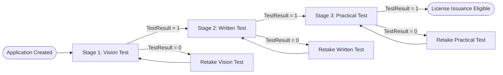
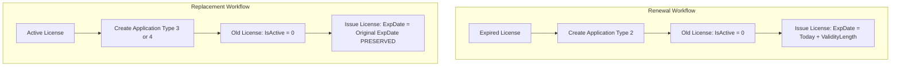

# 09 – Architecture and System Design Decisions

[← Back to Index](../README.md)

---

## 1. Overview

This document provides a comprehensive technical analysis of the architectural, data-tier, domain-level, security, and user-interface design decisions made in the DVLD (Driving and Vehicle License Department) system. 

For each decision, this document articulates the **Problem Context**, the **Decision Made**, the **Technical Implementation**, the **Rationale & Benefits**, and the **Trade-offs & Constraints**.

---

## 2. Design Decision Matrix

| # | Domain | Decision | Key Benefits | Trade-Offs |
|---|---|---|---|---|
| **DD-01** | Architecture | Classic Three-Tier Layering with Direct Project References | Strict separation of concerns, compile-time safety, zero DI container overhead | Tight assembly coupling |
| **DD-02** | Data Access | Single-Responsibility Static DAL Classes (No ORM) | Maximum SQL performance, transparency, easy debugging | Proliferation of granular static classes |
| **DD-03** | Database | Supertype/Subtype Inheritance (`Applications` -> `LocalDrivingLicenseApplications`) | Unified accounting, common audit trail, centralized status tracking | Requires multi-table joins or database views |
| **DD-04** | Business Logic | Sequential 3-Stage Testing Pipeline Gatekeeper | Strict regulatory compliance, tamper-proof appointments | Requires sequential DB validations |
| **DD-05** | Workflow | Composite Fee Retake Test Workflow | Prevents re-examination fee evasion, full attempt audit history | Generates distinct sub-application per retry |
| **DD-06** | License Lifecycle | Renewal vs. Replacement Expiration Rule | Prevents fraudulent validity extensions via replacement claims | Requires distinct calculation logic per issue reason |
| **DD-07** | Domain Model | Person vs. User vs. Driver Role Separation | Clean identity deduplication, lazy driver creation | Requires conditional lookup before license issue |
| **DD-08** | Penalties | DetainedLicenses Penalty Record vs. Release Service Application | Enforces unpaid impoundment tracking without premature application billing | Two-step workflow (Detain -> Release) |
| **DD-09** | Legal Compliance | International License Prerequisite (Class 3 Only, 1-Year Expiration) | 1949 Geneva Convention compliance | Hardcoded Class 3 prerequisite in BLL |
| **DD-10** | Presentation | Composite Reusable User Controls Pattern | Eliminates UI code duplication across 20+ forms | Control-to-host event communication overhead |
| **DD-11** | Security | AES-256 Symmetric Password Encryption & Universal SQL Parameterization | Zero plain-text credentials in DB/storage, 100% SQL injection immunity | Hardcoded symmetric key in source utility |
| **DD-12** | Entity Lifecycle | In-Memory `enMode` State Machine Pattern | Idempotent saving, prevents duplicate inserts in the same session | Requires manual mode management in constructors |

---

## 3. In-Depth Technical Design Decisions

### DD-01: Classic Three-Tier Layering with Direct Project References

#### Context & Problem
A vehicle licensing authority handles legal identities, fee transactions, and regulatory authorizations. Mingling SQL statements inside UI forms or scattering business validations across controls causes code duplication, security vulnerabilities, and high maintenance costs.

#### Decision
Implement a strict Three-Tier architecture partitioned across distinct Visual Studio projects:
```
FrontEnd (WinForms .exe)
  └── References ──> BussinessLogicLayer (Class Library .dll)
                        └── References ──> DataAccessLayer (Class Library .dll)
                                              └── Connects ──> SQL Server (MyDVLD)
```
- Direct project references are used instead of Dependency Injection (DI) containers.
- Circular references are prohibited at the compiler level.
- FrontEnd has no reference to DataAccessLayer.

#### Rationale & Benefits
- **Zero Overhead:** Eliminates DI container configuration and reflection overhead, ensuring instantaneous Windows Forms boot times.
- **Maintainability:** Clear boundaries ensure UI developers cannot execute raw SQL, and business rules remain independent of UI presentation controls.

#### Trade-Offs
- Mocking the data tier for unit testing without an interface abstraction layer requires integration testing against SQL Server or local database snapshots.

---

### DD-02: Single-Responsibility Static DAL Classes (No Heavy ORM)

#### Context & Problem
Heavy Object-Relational Mappers (such as Entity Framework) add abstraction overhead, complex change tracking, and implicit queries that can produce unpredictable SQL execution plans for high-integrity desktop applications.

#### Decision
Implement the Data Access Layer as a collection of focused, lightweight static classes where each class encapsulates a single database operation:
- `clsAddNewPerson`, `clsUpdatePerson`, `clsDeletePerson`, `clsGetBPersonInfo`, `clsFindPersonBy`
- `clsAddNewLicense`, `clsDisableLicenseByLicID`, `clsCheckIfTheLicenseHasExpiredOrNot`
- `clsAddNewTestAppointment`, `clsUpdateTestAppointment`, `clsLockTestAppointment`

Each method uses direct ADO.NET (`SqlConnection`, `SqlCommand`, `SqlDataReader`, `SqlDataAdapter`) with centralized connection retrieval via `dbSettings.DbConnection()`.

#### Rationale & Benefits
- **Predictable Performance:** Exact T-SQL control without ORM runtime translation overhead.
- **Micro-Granularity:** Developers can immediately locate the exact query executed for any specific operation without searching massive repository files.
- **Explicit Parameterization:** Every SQL input is explicitly typed and parameterized via `cmd.Parameters.AddWithValue()`.

#### Trade-Offs
- Creates a large number of discrete `.cs` files in the `DataAccessLayer` directory.
- Requires boilerplate ADO.NET `try-catch-finally` blocks in each method.

---

### DD-03: Supertype/Subtype Table Inheritance for Generalized Applications

#### Context & Problem
The department provides multiple distinct citizen services:
1. New Local Driving License
2. License Renewal
3. Replacement for Lost Card
4. Replacement for Damaged Card
5. Release Detained License
6. New International License
7. Retake Test

Each service involves financial accounting (fees paid), applicant identity, creation timestamp, operator auditing (`CreatedByUserID`), and lifecycle status (`New`, `Cancelled`, `Completed`). Creating separate disjoint tables for every service would fragment financial auditing and reporting.

#### Decision
Adopt the **Table-per-Type (TPT) / Supertype-Subtype** relational pattern:
- The base table `Applications` records all generic transactional metadata:
  ```sql
  Applications (ApplicationID, ApplicantPersonID, ApplicationDateTime, ApplicationTypeID,
               ApplicationStatus, LastStatusDateTime, PaidFees, CreatedByUserID)
  ```
- Specific applications that require specialized attributes link to `Applications` through a 1:1 foreign key:
  ```sql
  LocalDrivingLicenseApplications (LocalDrivingLicenseApplicationID, LApplicationID, LLicenseClassID)
  ```
- Services that only require base transaction metadata (e.g., Renew, Replace, Retake, Release) store their specific results in target lifecycle tables (`Licenses`, `TestAppointments`, `DetainedLicenses`) linked directly to `ApplicationID`.

#### Rationale & Benefits
- **Unified Auditing & Accounting:** Revenue reconciliation and daily transaction audits query a single table (`Applications`).
- **Standardized State Machine:** All services transition through identical status codes (`1 = New`, `2 = Cancelled`, `3 = Completed`).

#### Trade-Offs
- Requires relational `INNER JOIN` operations or database views (e.g., `LocalDrivingLicenseApplicationsView`, `DetailedApplicationInfo`) to present consolidated records to the UI.

---

### DD-04: Sequential 3-Stage Testing Pipeline Gatekeeper

#### Context & Problem
Government driving regulations mandate that candidates demonstrate competency in three sequential phases:
1. **Vision Test** (physical/sensory fitness)
2. **Written Test** (traffic laws, road signs, and theoretical knowledge)
3. **Practical Test** (street driving mechanics and vehicle control)

Allowing a candidate to take the Written test before passing Vision, or taking Practical before passing Written, violates statutory regulations.

#### Decision
Enforce sequential testing gates at both the Business Logic Layer and Presentation Layer:
- To schedule a Written Test appointment, the system queries `clsCheckExistence.CheckIfVisionTestHasCompletedOrNot(LDLAppID)` verifying a passed Vision test exists (`TestResult = 1`).
- To schedule a Practical Test appointment, the system queries `clsCheckExistence.CheckIfWrittenTestHasCompletedOrNot(LDLAppID)`.
- **Appointment Immutability:** Once an exam is executed, the appointment is permanently locked (`IsLocked = 1`). A locked appointment cannot be edited, rescheduled, or deleted.



#### Rationale & Benefits
- Eliminates human operator scheduling mistakes.
- Preserves complete integrity of examination logs for regulatory compliance.

---

### DD-05: Retake Test Workflow with Composite Fee Generation

#### Context & Problem
When an applicant fails an examination stage, simply allowing the operator to change the date of the failed appointment would overwrite examination history and bypass statutory re-examination fees.

#### Decision
Implement an automated Retake Test workflow:
1. The failed appointment remains permanently locked with `TestResult = 0` and `IsLocked = 1`.
2. When the operator schedules a new attempt for that test type, the system identifies the failure via `clsCheckIfTheTestHasTakenAndFailedOrNot`.
3. The system automatically creates a new parent application in `Applications` with `ApplicationTypeID = 7` ("Retake Test") charging the statutory retake fee ($5).
4. The newly created `ApplicationID` is linked to the new `TestAppointment` record via the foreign key `RetakeApplicationID`.
5. The total payable fee is dynamically calculated and displayed as:
   `$$\text{Total Fee} = \text{Retake Application Fee (\$5)} + \text{Test Type Schedule Fee}$$`

#### Rationale & Benefits
- Guarantees 100% financial compliance and prevents revenue leakage from unbilled retakes.
- Preserves a complete historical audit of every examination attempt, score, and note.

---

### DD-06: Distinct Lifecycles for License Renewal vs. Replacement (Expiration Preservation Rule)

#### Context & Problem
A driver holding an expiring license must renew it and pay the full renewal fee. A driver with a damaged or lost card must replace it. If replacement were implemented simply as a renewal, drivers with near-expired licenses could falsely report a "damaged" card at a lower fee to obtain a full 10-year validity extension.

#### Decision
Strictly distinguish between **Renewal** and **Replacement** lifecycles:

1. **Renewal (`clsRenewLicense`):**
   - **Prerequisite:** License must be expired (`ExpirationDate < DateTime.Now`).
   - **Validity:** The renewed license receives a brand new expiration date calculated from the current date:
     $$\text{New Expiration Date} = \text{Current Date} + \text{LicenseClass.DefaultValidityLength}$$
   - **Old Card:** Old license is deactivated (`IsActive = 0`).
   - **Application Type:** Type 2 ("Renew Driving License Service").

2. **Replacement (`clsReplacementLicense`):**
   - **Prerequisite:** License must be active and not expired.
   - **Expiration Preservation Rule:** The replacement license **preserves the exact expiration date** of the original card:
     $$\text{Replacement Expiration Date} = \text{OriginalLicense.ExpirationDate}$$
   - **Old Card:** Original license card is deactivated (`IsActive = 0`).
   - **Application Type:** Type 3 ("Replacement for Damaged License") or Type 4 ("Replacement for Lost License").



#### Rationale & Benefits
- Closes the loophole preventing applicants from bypassing full renewal pricing by claiming card loss or damage.

---

### DD-07: Person vs. User vs. Driver Entity Distinction (Lazy Driver Registration)

#### Context & Problem
Citizens register with the department, staff members operate the system, and licensed individuals drive on public roads. Treating all actors as a single flat "User" or "Driver" entity causes data integrity failures and duplicate person profiles.

#### Decision
Deconstruct identity into three distinct, non-overlapping relational entities:

1. **`People` (Demographic Identity):**
   - The universal root identity. Contains National Number, Full Name, DOB, Gender, Address, Phone, Email, and Photo.
   - Strict uniqueness constraints: `UQ_NationalNumber`, `UQ_Phone`, `UQ_Email`.
2. **`Users` (System Operator Credentials):**
   - System staff account linked to a `PersonID`.
   - Constrained to `1:1` via `clsCheckUserExistence.IsPersonIsAUser()`.
   - Stores AES-256 encrypted passwords and `IsActive` toggle.
3. **`Drivers` (Licensed Driver Authority Registry):**
   - **Lazy Creation Strategy:** A person is **not** added to `Drivers` when they apply, nor when they pass tests. They become a Driver **only upon the successful issuance of their first driving license** (`clsDrivers.Save()`).
   - Once created, the `DriverID` is permanent and referenced by all subsequent licenses issued across different vehicle classes.

#### Rationale & Benefits
- Prevents database bloat from storing applicants who fail exams as registered drivers.
- Ensures a single person holds exactly one `DriverID` regardless of how many license classes they acquire (Motorcycle, Car, Heavy Truck, etc.).

---

### DD-08: Detention Penalty Record vs. Release Service Application

#### Context & Problem
When traffic police or the authority impounds a suspended or violated license, the detention is a penalty action, not a citizen-initiated service request. However, when the citizen pays the fine and retrieves the card, the release is a formal fee-paying administrative service.

#### Decision
Structure the detention/release lifecycle across distinct tables and states:
1. **Detention Phase:**
   - Handled directly in `DetainedLicenses` without creating an `Applications` entry.
   - Records `DLicenseID`, `DetainDateTime`, `FineFees` (enforced via `CHECK (FineFees > 0)`), `ISReleased = 0`, and `CreatedByUserID`.
   - Active detention check (`ISReleased = 0`) prevents double-detaining an already impounded license.
2. **Release Phase:**
   - Creates a formal administrative application in `Applications` with `ApplicationTypeID = 5` ("Release Detained Driving License", fee = $15).
   - Updates the existing `DetainedLicenses` row:
     `SET ISReleased = 1, ReleasedDateTime = GETDATE(), ReleasedByUserID = @UserID, ReleaseApplicationID = @ReleaseAppID`.

#### Rationale & Benefits
- Avoids misrepresenting an involuntary legal penalty as an "application".
- Guarantees that released licenses track both the officer who detained the card and the officer who processed the release.

---

### DD-09: International Driving License Prerequisite Enforcement

#### Context & Problem
Under the 1949 Geneva Convention on Road Traffic, international driving permits are translation documents that are legally valid only when accompanied by a valid domestic ordinary driving license.

#### Decision
Hardcode the prerequisite verification in `clsInternationalLicense.CheckBeforeAdd()`:
1. The domestic license must be **Class 3 – Ordinary Driving License** (`license.LicenseClassID == 3`). Other license classes (e.g., Motorcycle, Light Commercial) cannot be used to obtain an international permit under system rules.
2. The domestic license must be active (`IsActive = 1`) and not expired.
3. The domestic license must not be detained.
4. The applicant must not already hold an active international permit (`!IsPersonHasActiveInternationalLicense()`).
5. The international license validity is strictly set to **1 year**:
   $$\text{ExpirationDate} = \text{IssueDate} + 1\text{ Year}$$
6. **Cascading Deactivation:** If the parent domestic license is renewed, replaced, or deactivated, linked international permits are deactivated.

#### Rationale & Benefits
- Guarantees compliance with international road traffic conventions.
- Protects the authority from issuing unauthorized international credentials.

---

### DD-10: Composite Reusable User Controls Architecture

#### Context & Problem
Across more than 20 Windows Forms dialogs, operators repeatedly need to:
- Search for a person by National Number or Person ID and view their summary.
- Search for a license card by License ID and display driver details.
- Display application metadata, fees, and timestamps.
Writing this UI code independently inside each Form caused massive code duplication and inconsistent user experiences.

#### Decision
Adopt the **Composite User Control Pattern** in the `FrontEnd` project:

| User Control | Embedded Responsibilities | Host Forms |
|---|---|---|
| `ctrlPersonInfo` | Displays complete citizen portrait, demographic card, and nationality | `frmShowPersonDetails`, `ctrlFilterFindBy`, `ctrlShowUserInfo` |
| `ctrlFilterFindBy` | Search bar supporting National Number and Person ID filtering with auto-populated `ctrlPersonInfo` | `frmAddEditLocalDrivingLicense`, `frmAddEditUser` |
| `ctrlDriverLicenseInfo` | Displays complete license card details, driver info, and license class specifications | `frmShowLicense`, `ctrlFilterFindLicenseByLicID` |
| `ctrlFilterFindLicenseByLicID` | Search bar for License ID with integrated license details card | `frmRenewLicense`, `frmReplacementForDamagedLic`, `frmDetainLicense`, `frmReleaseLicense`, `frmNewInternationalLicense`, `frmLicenseHistory` |
| `ctrlLocalDrivingLicenseInfo` | Displays application ID, license class, passed test count, and base application summary | `frmShowLocalDrivingLicApplicationDetails`, `frmTestVisionAppointments`, `frmManageWrittenTestAppointments`, `frmManagePracticalTestAppointments`, `frmAddNewLicense` |
| `ctrlScheduleTestInfo` | Displays appointment scheduling details, trial count, and fee compilation | `frmAddNewAppointment`, `frmTakeTest` |

#### Rationale & Benefits
- **DRY (Don't Repeat Yourself):** Complex search, validation, and layout logic is written and tested once.
- **Consistent UX:** When a user looks up a license in Renew, Replace, Detain, or Release, the display format is identical.

---

### DD-11: Cryptographic Strategy & Universal SQL Parameterization

#### Context & Problem
Desktop database applications with network connections to SQL Server face credential theft risks (plain-text passwords in memory or database backups) and SQL injection vulnerabilities.

#### Decision
1. **AES-256 Symmetric Password Encryption:**
   - Implemented in `clsEncryptDecrypt` using .NET `System.Security.Cryptography.Aes`.
   - Passwords are encrypted before database transmission; plain-text passwords are never stored in `Users.Password`.
   - "Remember Me" credentials serialized to `C:\DVLDSavedLoginInfo\SavedLogin.json` store only the encrypted string.
2. **Universal Parameterization:**
   - Every query in `DataAccessLayer` binds user input through `SqlCommand.Parameters.AddWithValue()`.
   - Dynamic T-SQL concatenation (`"WHERE NationalNumber = '" + input + "'"`) is strictly banned.

#### Rationale & Benefits
- Immunity to SQL injection attacks across all search filters and inputs.
- Passwords are safe from casual database inspection.

#### Known Security Trade-Off
- The symmetric key and IV are currently stored as hardcoded constants inside `clsEncryptDecrypt.cs`. In an enterprise production deployment, these should be managed via Windows Data Protection API (DPAPI) or Azure Key Vault.

---

### DD-12: In-Memory `enMode` State Machine Pattern

#### Context & Problem
WinForms forms often serve dual purposes: adding a new record or editing an existing one (e.g., `frmAddEditPerson`, `frmAddEditUser`). If the business object does not track its state, saving an object twice in the same session can accidentally insert duplicate rows instead of updating the existing row.

#### Decision
Implement a standardized in-memory state machine pattern across all domain entities:
```csharp
public class clsPeople
{
    private enum enMode { AddNew = 0, Update = 1 }
    private enMode _Mode;

    // Add Constructor
    public clsPeople()
    {
        _Mode = enMode.AddNew;
        this.PersonID = -1;
    }

    // Edit/Update Constructor
    private clsPeople(int PersonID, string NationalNumber, ...)
    {
        _Mode = enMode.Update;
        this.PersonID = PersonID;
        // ...
    }

    public bool Save()
    {
        switch (_Mode)
        {
            case enMode.AddNew:
                if (_AddNew())
                {
                    _Mode = enMode.Update; // Automatically switch mode on successful insert
                    return true;
                }
                return false;

            case enMode.Update:
                return _Update();
        }
        return false;
    }
}
```

#### Rationale & Benefits
- **Idempotency:** Calling `person.Save()` multiple times in the same form session inserts on the first call and safely updates on all subsequent calls.
- **Encapsulation:** The UI form simply calls `Save()` without needing to know whether the entity is in Add or Update state.

---

## 4. Cross-Reference to System Documents

- For end-to-end user workflows, see [02 – Feature Documentation](./02-features.md).
- For complete layer diagrams and dependencies, see [03 – System Architecture](./03-architecture.md).
- For database schemas and views, see [04 – Database Documentation](./04-database.md).
- For individual BLL classes and state machines, see [05 – BLL Documentation](./05-bll.md).
- For individual DAL classes and parameterized queries, see [06 – DAL Documentation](./06-dal.md).
- For UI controls and form structures, see [07 – Frontend Documentation](./07-frontend.md).
- For requirements-to-code mapping, see [08 – Cross-Layer Traceability](./08-traceability.md).
- For original system requirements, see [Requirements Specification](./Requirements.md).
